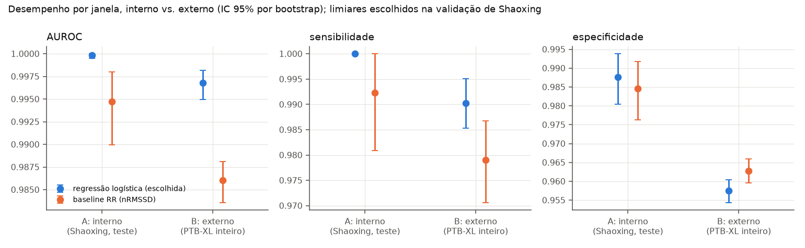
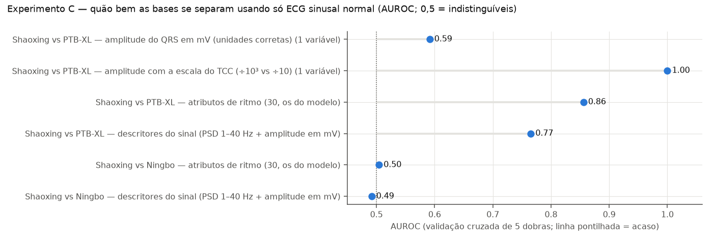
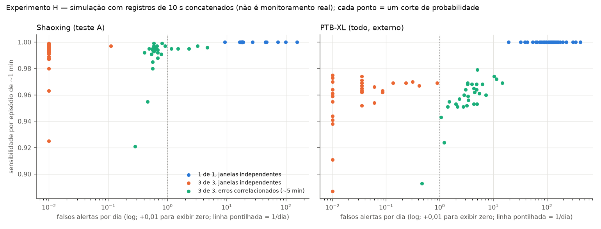

# On-board atrial fibrillation detector for single-lead ECG

**NASA Space Apps Challenge 2026 · research prototype** · [Versão em português](README.md)

> **Not a medical device and not a diagnosis.** Research prototype and decision-support tool only.
> Not validated in astronauts or in microgravity. All data are public, terrestrial, resting clinical ECGs
> from PhysioNet. **They are not NASA data and not astronaut data.**

*This file is generated by `make report` from `docs/templates/README.en.template.md`. Every number in it comes
from a file in `results/` (or, for design constants, from `configs/default.yaml`). The source of each value
is listed in [`results/readme_numbers.json`](results/readme_numbers.json).*

## What this is

A wearable single-lead ECG (Holter-like, lead I, 250 Hz) streams to a Raspberry Pi. Every 9.6-s window
(2,400 samples) is analysed **on board, during the recording, without contacting Earth**:

1. **Signal quality (SQI)** → `SINAL_RUIM` (bad signal), no clinical message.
2. **ML model: AFIB vs. sinus rhythm** (logistic regression on 30 interpretable features: RR
   irregularity, atrial activity, morphology, spectrum). Sinus bradycardia and tachycardia are trained as
   *non-AFIB*, to teach the model that an altered rate alone is not fibrillation. Out of the training source
   it still confuses them more often (Exp. E). The lightweight QRS detector agrees
   with the `wfdb` XQRS reference on real records (sensitivity ≥ 0.992, PPV ≥ 0.982).
3. **Heart-rate rule** → mild `AVISO_FC_BAIXA` / `AVISO_FC_ALTA` warnings (defaults 60 / 100 bpm,
   adapted to the person's own history).

`ALERTA_AFIB` is raised only when AFIB is seen in 3 of 3 consecutive windows. Low-confidence
or out-of-distribution inputs return `INCERTO` (review).

The claim is **early detection of the rhythm present in the window**, not prediction of future events.
The defensible argument is *on-board analysis during the recording* plus a head-to-head comparison with
an RR-irregularity baseline on the same test sets. Comparisons with the literature are only a reference:
they do not use our test sets. We make **no claim** about myocardial infarction, cardiac arrest or
ventricular arrhythmias, and no claim of being better than a Holter.

Starting point: the undergraduate thesis by Maggioni & Rebonatto (UPF, 2023); the PDF is not redistributed here
(full citation in [`DATA.md`](DATA.md)). We reuse
its datasets and its limited-signal scenario (lead I, 250 Hz, 0.05–30 Hz, 12-bit
positive-only A/D) and fix its evaluation problems (see [`docs/tcc_analysis.md`](docs/tcc_analysis.md)).

## Why AFIB on board

- A National Academies review of NASA's evidence reports concluded that "a greater emphasis in the evidence
  report on the risk of atrial fibrillation is supported by contemporary experience", and that management of
  AFIB arising in long-duration flight needs to be explored (2017 letter report).
- Khine et al. (2018) report an AFIB prevalence of about 5% in active astronauts, similar to the
  general population but at a younger age, and transient left-atrial enlargement after 6
  months in space. They also found **no AFIB episodes** in the crew they studied. The case for AFIB is a risk
  argument, not observed in-flight AFIB.
- AFIB is often intermittent or silent, so automatic on-board detection adds value, and it is detectable on
  a single lead. Sources: `results/reference/literature.json`.

## Data (audit: [`docs/data_audit.md`](docs/data_audit.md))

| Source | Records | AFIB | Role |
|---|---|---|---|
| Chapman-Shaoxing (part of PhysioNet *ecg-arrhythmia* v1.0.0) | 10,247 | 1,779 | training / internal test (Exp. A) |
| Ningbo (same PhysioNet release) | 34,905 | 0 | source-signature test, extra negatives only |
| PTB-XL v1.0.3 | 21,799 | 1,477 | **external validation** (Exp. B) |

Key audit findings that shaped the design:

- The *ecg-arrhythmia* release mixes two hospitals. **All AFIB is in Shaoxing; Ningbo has none.** We
  inferred the boundary and checked it against the per-source counts of the PhysioNet/CinC 2021 tables
  (93 of 94 codes identical). Using the whole release would let the *source* predict the
  label, which is the main flaw we found in the thesis design. Experiment A therefore uses Shaoxing only.
- Ningbo's "atrial flutter" label is unreliable: 12 signals that Shaoxing labels AFIB appear,
  bit-identical, in Ningbo labelled as flutter.
- 13,191 records use SNOMED codes missing from the official dictionary. They were resolved with the
  CinC 2021 mapping tables; without them, paced and junctional rhythms would have been counted as normal sinus.
- Units were read from the WFDB headers and checked empirically (QRS amplitudes in plausible mV).

## Results

All numbers below are per 9.6-s window, with 95% bootstrap CIs where shown. Operating thresholds were
chosen on the Shaoxing validation split (specificity ≥ 0.98) and **frozen** before any test set was
opened. Full tables: `results/exp*/`.

### Internal test (Exp. A, Shaoxing, same source)

Test set: 1,230 windows, 261 AFIB (21% prevalence). Negatives are clean sinus rhythm (normal,
other findings, brady, tachy); hard confounders are tested separately (Exp. E, G).

| Model | AUROC | AUPRC [95% CI] | Sensitivity [95% CI] | Specificity [95% CI] | PPV |
|---|---|---|---|---|---|
| RR-irregularity baseline (nRMSSD, no learning) | 0.9947 | 0.965 [0.934–0.989] | 0.992 [0.981–1.000] | 0.985 [0.976–0.992] | 0.945 |
| **Logistic regression (chosen)** | 0.9998 | 0.999 [0.998–1.000] | 1.000 [1.000–1.000] | 0.988 [0.980–0.994] | 0.956 |
| Random forest | 0.9998 | 0.999 [0.998–1.000] | 1.000 [1.000–1.000] | 0.985 [0.976–0.992] | 0.946 |
| LightGBM | 0.9999 | 1.000 [0.999–1.000] | 1.000 [1.000–1.000] | 0.987 [0.978–0.993] | 0.953 |
| Compact 1D CNN (reference) | 0.9991 | 0.997 [0.993–0.999] | 0.992 [0.981–1.000] | 0.988 [0.980–0.994] | 0.956 |

**Model choice (pre-registered):** the simplest model whose validation AUPRC is within 0.010 of the best,
in the order logistic regression → random forest → LightGBM → CNN. Validation AUPRC: logistic 0.9997,
random forest 0.9980, LightGBM 0.9997, CNN 0.9966 → **logreg**. The rule and
the choice were committed before the test set was opened (`results/expA/selection.json`,
`results/expA/TEST_OPENED.json`).

### External validation (Exp. B): train on Shaoxing, test on all of PTB-XL



| Train → test | AUROC | Sensitivity | Specificity | PPV | AFIB / non-AFIB |
|---|---|---|---|---|---|
| Shaoxing → Shaoxing (internal) | 0.9998 | 1.000 | 0.988 | 0.956 | 261 / – |
| **Shaoxing → PTB-XL (external)** | **0.9968** [0.995–0.998] | **0.990** [0.985–0.995] | **0.957** [0.954–0.960] | **0.677** | 1,428 / 15,877 |
| PTB-XL → PTB-XL (fold-10 test) | 0.9914 | 0.952 | 0.969 | 0.738 | 145 / 1,581 |
| PTB-XL → Shaoxing (inverse) | 0.9995 | 1.000 | 0.979 | 0.929 | 261 / 969 |

**Drop from A to B:** sensitivity holds, but **specificity falls from 0.988 to 0.957**, i.e.
about 3.4× more false-positive windows. PPV also falls, partly because PTB-XL prevalence is lower
(8%). The logistic regression generalised at least as well as the more complex models (external
AUROC 0.9968 vs. random forest 0.9958 and LightGBM 0.9957, with
overlapping CIs) and better than the CNN (0.9914), so choosing the simplest model cost nothing.
**Calibration does not transfer:** overall external ECE is 0.013, but PTB-XL windows with a predicted
probability between 0.5 and 0.9 are AFIB only 3%–24% of the time. The displayed
probability is overconfident outside the training source (`results/expB/calibration_external.json`). Restricting PTB-XL to
human-validated reports gives specificity 0.956.

### Comparison with the RR baseline (Exp. D, paired, same windows)

- **Ranking (threshold-free):** the model beats the baseline on both test sets. Paired bootstrap ΔAUROC
  +0.005 (+0.002 to +0.009) internal and +0.011 (+0.009 to +0.012) external; ΔAUPRC +0.034
  and +0.178.
- **At the frozen operating point the picture is mixed.** Internally the difference is not significant
  (McNemar p = 0.267). **Externally the baseline makes fewer errors** (621 vs. 689,
  McNemar p = 0.003): the model's threshold, set where the classes separate almost perfectly, does not
  transfer as well as the baseline's.

### Source-confusion test (Exp. C)



- With the scaling described in the thesis (one dataset divided by a thousand, the other by ten), **QRS
  amplitude alone separates the datasets with AUROC 1.00**, without any model. With correct units the
  same feature gives 0.59.
- With consistent units and filtering, the dataset signature is moderate: AUROC 0.86 using our rhythm
  features and 0.77 using generic signal descriptors. Shaoxing vs. Ningbo: 0.50 (no signature).
- Reproducing the thesis design (AFIB from Chapman, normals from PTB-XL), our logistic model does **not**
  exploit the source: AUROC 0.9999 on the mixed test and 1.0000 / 0.9958 on same-source
  tests. A source-sensitive descriptor model loses specificity when negatives switch to the training source
  (0.896 → 0.786).

### False alarms in (simulated) continuous monitoring (Exp. H)

There are 9,000 non-overlapping windows per day. With the thesis' reported specificity (98.5%) that would
be roughly 139 false alerts per day if errors were independent. Our numbers come from a
**simulation that concatenates isolated windows from different patients**, with artificial transitions:



| Scenario (false alerts per day) | Shaoxing test | PTB-XL (external) |
|---|---|---|
| No voting (alert on any AFIB window) | 18 | 115 |
| 3-of-3 voting, windows independent | 0.00 | 0.01 |
| 3-of-3, **correlated errors** (each record repeated ~5 min) | 0.6 | 4.0 |
| Person whose baseline rhythm is frequent ectopy | – | 53 to 179 |
| Person whose baseline rhythm is sinus arrhythmia | – | 46 to 57 |

Episode sensitivity with 3-of-3 on PTB-XL: 1.000 for ~5-min AFIB episodes, 0.960
for ~1-min episodes; median time to alert 29 s. **The independent-window figure is optimistic.** Real
errors within one person are correlated, and people with frequent ectopy or sinus arrhythmia would receive
many false alerts.

### Other experiments

- **Altered rate (Exp. E).** False-AFIB rate (per window) in Shaoxing: brady 1.2%, tachy
  1.6%. **Externally it rises: PTB-XL brady 9.2%, tachy 6.6%** (vs. normal
  sinus 3.4%); Ningbo tachy 7.5%. The heart-rate rule flags at least 98.2% of
  labelled bradycardias and 98.2% of tachycardias. It also flags 18% of PTB-XL
  "normal" ECGs as low HR (mild warning only).
- **Robustness (Exp. F, real noise from the MIT-BIH Noise Stress Test Database).** Sensitivity stays
  ≥ 0.996 under all noise. The 12-bit device conversion has no effect (specificity
  0.990 vs. 0.988 clean). **Specificity collapses under muscle noise and electrode
  motion:** muscle noise at 0 dB → 0.799; at −6 dB → 0.367. The SQI barely helped
  (0.411); recalibrated on validation (bSQI ≥ 0.95) it reaches 0.547, at the cost of
  rejecting 3.4%–8.2% of clean windows (was 1.8%–5.9%).
  See `results/figures/expF_robustness.png`.
- **Rhythms outside training (Exp. G).** Share of windows classified AFIB: **atrial flutter 55%**
  (Shaoxing) / 29% (PTB-XL), atrial tachycardia 44%, ectopy 24%–31%, sinus
  arrhythmia 15%–21%, SVT 6%. `INCERTO` catches only part of these. Ningbo's
  "flutter" is classified AFIB 84% of the time, consistent with the label problem above. See
  `results/figures/fig_out_of_training.png`.
- **Thesis reference (Exp. I, three classes: AFIB, sinus brady, normal = model + HR rule).** Balanced test:
  accuracy 98.8% on Shaoxing (201 per class) and **89.7% on external PTB-XL** (356
  per class, the thesis' test size). On PTB-XL, AFIB recall is 99.2% but only 79.5% of
  normals are recognised. The thesis reports 96.9% with a different protocol (normals and arrhythmias
  from different datasets). This is a reference, not a comparison.

### Literature (reference only, different test sets)

Smartwatch ECG algorithms: pooled sensitivity 86%, specificity 94% (meta-analysis,
J Arrhythm 2025). AI-assisted Holter analysis: AFIB sensitivity 98% vs. 91% for conventional
analysis (Fiorina et al., JAHA 2022). Both were checked at the primary source (`results/reference/literature.json`).

### On-board execution

Measured on **11th Gen Intel(R) Core(TM) i7-1165G7 @ 2.80GHz** (development laptop, single thread), **not on a Raspberry Pi**:
3.6 ms median per window (p95 4.2 ms) for the full pipeline (filtering, QRS
detection, features, SQI, model, voting); the model itself takes 0.05 ms. Resident memory is
about 104 MB with numpy/scipy loaded. The model artifact is 34 KB as JSON (numpy-only
inference) and 0.8 KB as ONNX. `scripts/benchmark.py` is ready to run on the Pi.

## Limitations

- **Not validated in astronauts, in microgravity, or on a real Holter.** Clinical resting ECGs from
  hospitals, replayed.
- Datasets contain isolated 10-s exams with no follow-up, so this is detection of the rhythm in the window,
  not prediction.
- **External specificity drops**, the frozen threshold transfers poorly, and the RR baseline makes fewer
  errors than the model at the external operating point.
- **Atrial flutter, atrial tachycardia, frequent ectopy and sinus arrhythmia are often called AFIB.**
  Flutter in particular needs dedicated handling.
- **Strong muscle noise / electrode motion breaks specificity**; the SQI is not good enough yet.
- **False alerts per day are only simulated.** With correlated errors, or for people with ectopy, they are
  far higher than the independent-window estimate.
- No patient identifiers in Chapman: the Shaoxing split is by record, so near-duplicate exams of one patient
  may cross splits (exact duplicates were removed).
- Strong age confounding: AFIB patients are much older. In the astronaut-like age band (30–54 years) the
  internal test has only 19 AFIB windows.
- No coverage of ventricular tachycardia or fibrillation; no claim is made about them.
- Raspberry Pi performance not measured; Holter → Pi transmission is out of scope (simulated by replay).

## Reproduce

Requirements: Linux/macOS, conda, about ten gigabytes of free disk and a 4.3 GB download from PhysioNet. CPU only.

```bash
make env && conda activate afib-onboard       # Python 3.12, pinned (requirements.lock)
make data          # download (resumable) + checksums + lead-I cache
make audit         # docs/data_audit.md
make features      # windows, features, SQI, QRS validation
make train         # Exp. A dev phase (CV, validation, pre-registered model choice)
make evaluate      # Exp. A test set, opened once (in a fresh clone: make evaluate EVAL_FLAGS=--reproduce)
make experiments   # Exp. B–I
make export        # models/afib_logreg_v1.json + .onnx
make benchmark     # latency / memory on this machine
make report        # figures + README.md (pt-BR) + README.en.md + MODEL_CARD.md from results/
make test
make demo          # local dashboard, no internet: http://localhost:8501
```

A quick end-to-end check on a subset: `make reproduce SUBSET=4000` (numbers will differ from the full run).
Decisions and deviations from the original plan: [`docs/decisions.md`](docs/decisions.md). Model card:
[`MODEL_CARD.md`](MODEL_CARD.md). Data sources, licences and citations: [`DATA.md`](DATA.md).

## Repository

```
configs/   all parameters (signal spec, labels, experiments, pre-registered rules)
src/       data, labels, preprocess, qrs, features, sqi, baseline, models, decision, evaluate, inference, demo
scripts/   pipeline steps (audit, features, exp_a, experiments, export, benchmark, stream, report)
app/       Streamlit dashboard (offline)
models/    final model artifact (JSON + ONNX) with metadata and data hashes
results/   metrics (JSON/CSV) and figures, all generated by code
docs/      data audit, thesis analysis, decision log, judges Q&A, document templates
tests/     unit tests, offset invariance, no leakage, inference parity, dashboard
```

## Next steps (not implemented)

- **AFIB prediction:** literature exists on predicting AFIB from sinus-rhythm ECG and heart-rate
  variability, mostly retrospective. It requires datasets with signal recorded before episode onset.
- **Ventricular arrhythmias:** VT and VF are the most serious risk but require other datasets.
- **Validation on a real Holter** and later on data from space analogues or flight.
- **NASA data:** integrate the challenge's health indicators into a broader health view.
- Ignore bad-signal windows in the voting (needs re-evaluation), handle flutter explicitly, improve the SQI.

## Citation and licences

Code: MIT. Data are not redistributed; see [`DATA.md`](DATA.md) for the required citations of Chapman-Shaoxing/
Ningbo (PhysioNet *ecg-arrhythmia*), PTB-XL, the MIT-BIH Noise Stress Test Database and PhysioNet. Starting
point: Maggioni, A. F.; Rebonatto, M. T. *Inteligência Artificial aplicada a análise de Eletrocardiograma*.
Undergraduate thesis, Universidade de Passo Fundo, 2023.

---

## Resumo (pt-BR)

Detector de **fibrilação atrial** que roda **a bordo**, em ECG de uma derivação, janela a janela
(9.6 s), sem depender da Terra. Tem três camadas: qualidade do sinal, modelo AFIB vs. sinusal
(regressão logística) e regra de frequência cardíaca. O alerta exige AFIB em 3 de 3
janelas seguidas. **Protótipo de pesquisa, não é dispositivo médico.** Os dados são clínicos, públicos e
terrestres: **não são da NASA nem de astronautas.**

- **Interno (Shaoxing):** sensibilidade 1.000, especificidade 0.988.
- **Externo (PTB-XL):** sensibilidade 0.990, especificidade **0.957**. A especificidade cai.
- **Contra o baseline RR:** melhor no ranqueamento, mas, no ponto de operação externo, o baseline erra menos.
- **Confusão de fonte:** com a escala do TCC, só a amplitude separa as bases (AUROC 1.00).
- **Falsos alertas/dia (simulados):** 0.01 com janelas independentes, cerca de 4.0 com erros
  correlacionados e dezenas por dia em pessoas com ectopia.
- **Limitações principais:** flutter, ectopia e arritmia sinusal viram AFIB com frequência; ruído muscular
  forte derruba a especificidade; nada foi validado em astronautas nem em Raspberry Pi.
