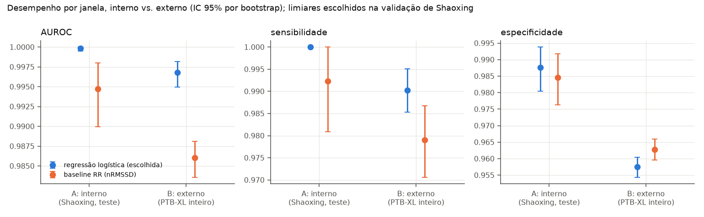
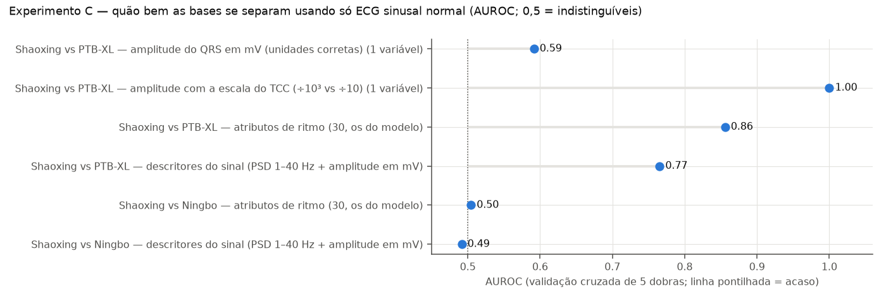
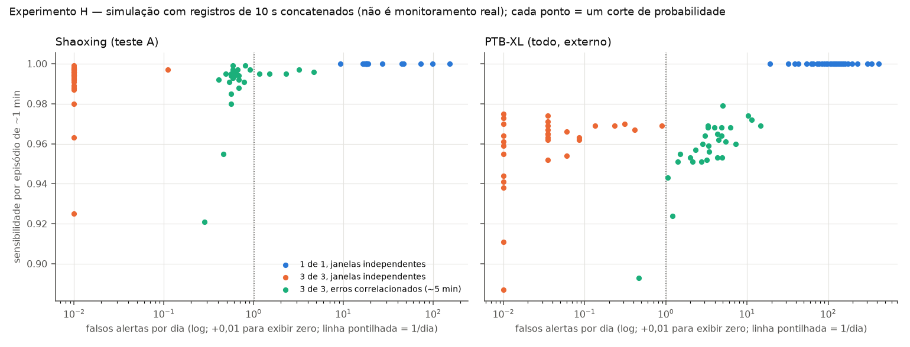

# Detector de fibrilação atrial a bordo para astronautas

**NASA Space Apps Challenge 2026 · protótipo de pesquisa** · [English version](README.en.md)

> **Não é dispositivo médico nem diagnóstico.** Este é um protótipo de pesquisa e apoio à decisão. Não foi
> validado em astronautas, em microgravidade nem com um Holter real. Todos os dados são ECGs clínicos,
> públicos, terrestres e de repouso, obtidos na PhysioNet. **Não são dados da NASA nem de astronautas.**

*Este README é gerado por `make report` a partir de `docs/templates/README.pt.template.md`. Todo número abaixo
vem de um arquivo em `results/` ou, quando é constante de projeto, de `configs/default.yaml`. A origem de cada
valor está em [`results/readme_numbers.json`](results/readme_numbers.json), e um teste automático impede
números escritos à mão.*

---

## Em uma frase

Um programa leve que roda num Raspberry Pi ligado a um ECG portátil de uma derivação (como um Holter). Ele
analisa o sinal em janelas de 9,6 s **durante a gravação, sem depender da Terra**, e avisa quando
encontra **fibrilação atrial (AFIB)**, controlando os falsos alarmes.

## Por que fibrilação atrial, e por que a bordo

- Uma revisão das Academias Nacionais dos EUA sobre os relatórios de risco à saúde da NASA concluiu que
  "a greater emphasis in the evidence report on the risk of atrial fibrillation is supported by contemporary
  experience", e que o manejo de AFIB surgida em voos longos precisa ser estudado (relatório de 2017).
- Khine et al. (2018) relatam prevalência de AFIB de cerca de 5% em astronautas ativos,
  semelhante à da população geral, mas em idade mais jovem, e aumento transitório do átrio esquerdo após
  6 meses no espaço. **O mesmo estudo não observou nenhum episódio de AFIB em voo.** O
  argumento, portanto, é de risco, não de AFIB frequente em órbita.
- A AFIB costuma ser intermitente ou sem sintomas, então um alerta automático tem valor. Ela é detectável numa
  única derivação. Em missões longas, a análise precisa acontecer localmente.

Fontes conferidas no original: `results/reference/literature.json`.

## Como funciona

O sinal-alvo é o do aparelho MP-IoT do TCC de partida: derivação I, 250 Hz, janelas de 2.400 amostras,
banda de 0,05 a 30 Hz e conversor A/D de 12 bits que só gera valores positivos. Cada
janela passa por três camadas:

1. **Qualidade do sinal (SQI).** Janela ruim → `SINAL_RUIM`, sem mensagem clínica.
2. **Modelo de ML: AFIB vs. ritmo sinusal.** Regressão logística sobre 30 atributos interpretáveis:
   irregularidade dos intervalos RR, atividade atrial (onda P), morfologia do QRS e espectro. Bradicardia e
   taquicardia sinusais entram no treino como *não AFIB*, para ensinar que só a frequência alterada não é
   fibrilação. Fora da base de treino, porém, ele ainda as confunde com mais frequência (experimento E). O
   detector de QRS, feito para ser leve, concorda com a referência XQRS do `wfdb` em dados reais
   (sensibilidade ≥ 0,992, PPV ≥ 0,982).
3. **Regra de frequência cardíaca.** Gera `AVISO_FC_BAIXA` / `AVISO_FC_ALTA`, avisos leves. Os limiares
   padrão são 60 e 100 bpm, adaptados ao histórico da própria pessoa, para que um atleta com FC
   de repouso baixa não receba aviso o tempo todo.

Por cima das camadas:

| Estado | Quando | Severidade |
|---|---|---|
| `SINAL_RUIM` | SQI reprovado | técnica |
| `INCERTO` | entrada fora do padrão do treino, ou confiança baixa | revisar |
| `ALERTA_AFIB` | AFIB em 3 de 3 janelas consecutivas | alta |
| `AVISO_FC_BAIXA` / `AVISO_FC_ALTA` | FC fora dos limiares, sem AFIB | leve |
| `OK` | ritmo sinusal, FC esperada | nenhuma |

**O que alegamos:** *detecção precoce do ritmo presente na janela* (não previsão de eventos futuros), análise
**a bordo durante o registro** e comparação justa com um baseline no mesmo conjunto de teste. **O que não
alegamos:** detectar infarto, parada cardíaca ou arritmias ventriculares, nem ser "melhor que o Holter".

**Ponto de partida:** o TCC de Maggioni & Rebonatto (UPF, 2023), em [`docs/`](docs/). Reaproveitamos as bases
e o cenário de sinal limitado, trocamos a rede profunda por modelos simples e corrigimos os problemas de
avaliação (ver [`docs/tcc_analysis.md`](docs/tcc_analysis.md)).

## Dados

Auditoria completa: [`docs/data_audit.md`](docs/data_audit.md).

| Fonte | Registros | AFIB | Papel |
|---|---|---|---|
| Chapman-Shaoxing (parte da *ecg-arrhythmia* v1.0.0, PhysioNet) | 10.247 | 1.779 | treino e teste interno (exp. A) |
| Ningbo (mesma publicação) | 34.905 | 0 | teste de assinatura de fonte; negativos extras |
| PTB-XL v1.0.3 | 21.799 | 1.477 | **validação externa** (exp. B) |

Achados da auditoria que mudaram o desenho:

- **A base "Chapman" junta dois hospitais, e toda a AFIB está em Shaoxing; Ningbo não tem nenhuma.**
  Inferimos a fronteira e a conferimos contra as contagens por fonte do PhysioNet/CinC 2021 (93 de
  94 códigos idênticos). Usar a base inteira faria o modelo aprender o *hospital* em vez da
  arritmia, o mesmo erro central que encontramos no TCC. Por isso o treino usa só Shaoxing.
- **O rótulo "flutter atrial" de Ningbo não é confiável:** 12 sinais rotulados AFIB em Shaoxing
  aparecem, idênticos bit a bit, como flutter em Ningbo.
- 13.191 registros usam códigos SNOMED ausentes do dicionário oficial. Foram resolvidos com as
  tabelas do CinC 2021; sem isso, ritmos de marcapasso e juncionais seriam contados como sinusais normais.
- As unidades foram lidas dos cabeçalhos WFDB e conferidas empiricamente (QRS em mV plausíveis).

## Resultados

Todos os números são **por janela de 9,6 s**, com IC 95% por bootstrap quando indicado. Os limiares
foram escolhidos na validação de Shaoxing (especificidade ≥ 0,98) e **congelados** antes de abrir
qualquer conjunto de teste. Tabelas completas em `results/exp*/`.

### Teste interno (experimento A, Shaoxing, mesma fonte)

São 1.230 janelas, 261 com AFIB (21% de prevalência). Os negativos são ritmo sinusal "limpo":
normal, com outros achados, bradi e taqui. Os confundidores difíceis são testados à parte (experimentos E e G).

| Modelo | AUROC | AUPRC [IC 95%] | Sensibilidade [IC 95%] | Especificidade [IC 95%] | PPV |
|---|---|---|---|---|---|
| Baseline de irregularidade RR (nRMSSD, sem aprendizado) | 0,9947 | 0,965 [0,934–0,989] | 0,992 [0,981–1,000] | 0,985 [0,976–0,992] | 0,945 |
| **Regressão logística (escolhida)** | 0,9998 | 0,999 [0,998–1,000] | 1,000 [1,000–1,000] | 0,988 [0,980–0,994] | 0,956 |
| Random Forest | 0,9998 | 0,999 [0,998–1,000] | 1,000 [1,000–1,000] | 0,985 [0,976–0,992] | 0,946 |
| LightGBM | 0,9999 | 1,000 [0,999–1,000] | 1,000 [1,000–1,000] | 0,987 [0,978–0,993] | 0,953 |
| CNN 1D compacta (referência) | 0,9991 | 0,997 [0,993–0,999] | 0,992 [0,981–1,000] | 0,988 [0,980–0,994] | 0,956 |

**Escolha do modelo (pré-registrada):** o mais simples cujo AUPRC de validação esteja a no máximo 0,010
do melhor, na ordem logística → Random Forest → LightGBM → CNN. AUPRC de validação: logística 0,9997,
RF 0,9980, LightGBM 0,9997, CNN 0,9966 → **logreg**. A regra e a escolha
foram commitadas antes de abrir o teste (`results/expA/selection.json`, `results/expA/TEST_OPENED.json`).
Os números internos estão perto do teto porque os negativos são sinusal limpo de uma única fonte. O número
que importa é o externo.

### Validação externa (experimento B): treino em Shaoxing, teste no PTB-XL inteiro



| Treino → teste | AUROC | Sensibilidade | Especificidade | PPV | AFIB / não AFIB |
|---|---|---|---|---|---|
| Shaoxing → Shaoxing (interno) | 0,9998 | 1,000 | 0,988 | 0,956 | 261 / – |
| **Shaoxing → PTB-XL (externo)** | **0,9968** [0,995–0,998] | **0,990** [0,985–0,995] | **0,957** [0,954–0,960] | **0,677** | 1.428 / 15.877 |
| PTB-XL → PTB-XL (fold 10) | 0,9914 | 0,952 | 0,969 | 0,738 | 145 / 1.581 |
| PTB-XL → Shaoxing (inverso) | 0,9995 | 1,000 | 0,979 | 0,929 | 261 / 969 |

- **Queda de A para B:** a sensibilidade se mantém, mas **a especificidade cai de 0,988 para
  0,957**, cerca de 3,4× mais janelas falso-positivas. O PPV também cai, em parte porque a
  prevalência no PTB-XL é menor (8%).
- **Entre os modelos,** a regressão logística generalizou pelo menos tão bem quanto os mais complexos (AUROC
  externo 0,9968, contra 0,9958 do RF e 0,9957 do LightGBM, com ICs
  sobrepostos) e melhor que a CNN (0,9914).
- **A calibração não se transfere:** o ECE externo geral é 0,013, mas janelas do PTB-XL com
  probabilidade prevista entre 0,5 e 0,9 são AFIB em apenas 3% a 24% dos
  casos. A probabilidade exibida é confiante demais fora da fonte de treino.
- **Restringindo o PTB-XL a laudos validados por humanos,** a especificidade é 0,956.

### Comparação com o baseline RR (experimento D, pareada, mesmas janelas)

- **Ranqueamento, sem limiar:** o modelo supera o baseline nos dois testes. No bootstrap pareado, ΔAUROC
  +0,005 (+0,002 a +0,009) no interno e +0,011 (+0,009 a +0,012) no externo; ΔAUPRC +0,034 e
  +0,178.
- **No ponto de operação congelado, o quadro é misto.** No interno, a diferença não é significativa
  (McNemar p = 0,267). **No externo, o baseline erra menos:** 621 contra 689
  erros, McNemar p = 0,003. O limiar do modelo foi escolhido onde as classes se separam quase
  perfeitamente e não se transfere tão bem quanto o do baseline.

### Teste de confusão de fonte (experimento C)



- **Com a escala descrita no TCC** (uma base dividida por mil, a outra por dez), só a amplitude do QRS
  separa as bases com **AUROC 1,00**, sem modelo nenhum. Com unidades corretas, a mesma variável dá
  0,59.
- **Com unidades e filtragem consistentes,** a assinatura de base é moderada: AUROC 0,86 com nossos
  atributos de ritmo e 0,77 com descritores genéricos do sinal. Shaoxing × Ningbo: 0,50, sem
  assinatura.
- **Reproduzindo o desenho do TCC** (AFIB da Chapman, normais do PTB-XL), nossa regressão logística **não**
  explora a fonte: AUROC 0,9999 no teste misto e 1,0000 / 0,9958 nos testes de mesma
  fonte. Já um modelo de descritores, sensível à fonte, perde especificidade quando os negativos passam a ser
  da base de treino (0,896 → 0,786).

### Falsos alarmes em monitoramento contínuo simulado (experimento H)

Um dia tem 9.000 janelas sem sobreposição. Com a especificidade relatada pelo TCC (98,5%), seriam
cerca de 139 falsos alertas por dia se os erros fossem independentes. Nossos números vêm de uma
**simulação que concatena janelas isoladas de pacientes diferentes**, com transições artificiais:



| Cenário (falsos alertas por dia) | Teste Shaoxing | PTB-XL (externo) |
|---|---|---|
| Sem votação (alerta em qualquer janela AFIB) | 18 | 115 |
| Votação 3 de 3, janelas independentes | 0,00 | 0,01 |
| 3 de 3, **erros correlacionados** (cada registro repetido por ~5 min) | 0,6 | 4,0 |
| Pessoa cujo ritmo de base é ectopia frequente | – | 53 a 179 |
| Pessoa cujo ritmo de base é arritmia sinusal | – | 46 a 57 |

- **Sensibilidade por episódio no PTB-XL**, com 3 de 3: 1,000 para episódios de AFIB
  de ~5 min e 0,960 para ~1 min. Tempo mediano até o alerta: 29 s.
- **O valor com janelas independentes é otimista.** Na vida real, os erros de uma mesma pessoa se repetem, e
  quem tem ectopia frequente ou arritmia sinusal receberia muitos falsos alertas.

### Outros experimentos

- **Frequência alterada (E):**
  - falso AFIB por janela em Shaoxing: bradi 1,2%, taqui 1,6%;
  - **fora da base de treino ele sobe:** PTB-XL bradi 9,2%, taqui 6,6% (contra
    3,4% em sinusal normal); Ningbo taqui 7,5%;
  - a regra de FC marca pelo menos 98,2% das bradicardias e 98,2% das taquicardias
    rotuladas, mas também marca como FC baixa 18% dos ECGs "normais" do PTB-XL (aviso leve).
- **Robustez a ruído real (F, MIT-BIH Noise Stress Test Database):**
  - a sensibilidade fica ≥ 0,996 sob qualquer ruído;
  - a conversão A/D de 12 bits não tem efeito (especificidade 0,990 contra 0,988 no
    sinal limpo);
  - **a especificidade despenca com ruído muscular e movimento de eletrodo:** ruído muscular a 0 dB →
    0,799, a −6 dB → 0,367;
  - o SQI inicial quase não ajudou (0,411). Recalibrado na validação (concordância entre detectores
    ≥ 0,95), chega a 0,547, ao custo de rejeitar 3,4% a 8,2% das
    janelas limpas (antes, 1,8% a 5,9%). Figura: `results/figures/expF_robustness.png`.
- **Ritmos fora do treino (G):**
  - fração de janelas classificadas como AFIB: **flutter atrial 55%** (Shaoxing) / 29%
    (PTB-XL), taquicardia atrial 44%, ectopia 24% a 31%, arritmia sinusal 15% a
    21%, taquicardia supraventricular 6%;
  - o estado `INCERTO` captura só parte desses casos;
  - o "flutter" de Ningbo é classificado como AFIB em 84% das janelas, o que reforça o problema de
    rótulo acima. Figura: `results/figures/fig_out_of_training.png`.
- **Referência ao TCC (I, três classes: AFIB, bradicardia sinusal, normal = modelo + regra de FC):** em teste
  balanceado, acurácia de 98,8% em Shaoxing (201 por classe) e **89,7% no PTB-XL
  externo** (356 por classe, o tamanho do teste do TCC). No PTB-XL, o recall de AFIB é
  99,2%, mas só 79,5% dos normais são reconhecidos. O TCC relata 96,9% com
  outro protocolo (normais e arritmias de bases diferentes). É uma referência, não uma comparação.

### Literatura (apenas referência; outros conjuntos de teste)

- **Algoritmos de ECG em smartwatch:** sensibilidade agregada 86% e especificidade 94%
  (meta-análise, J Arrhythm 2025).
- **Análise de Holter assistida por IA:** sensibilidade para AFIB de 98%, contra 91% na
  análise convencional (Fiorina et al., JAHA 2022).

Ambas conferidas na fonte primária (`results/reference/literature.json`).

### Execução a bordo

- **Medido em 11th Gen Intel(R) Core(TM) i7-1165G7 @ 2.80GHz** (notebook de desenvolvimento, uma thread), **não em Raspberry Pi**:
  3,6 ms de mediana por janela (p95 4,2 ms) no pipeline completo (filtros, detecção de
  QRS, atributos, SQI, modelo e votação). O modelo em si leva 0,05 ms.
- **Memória residente:** cerca de 104 MB com numpy e scipy carregados.
- **Artefato:** 34 KB em JSON (inferência só com numpy) e 0,8 KB em ONNX.
- **O `scripts/benchmark.py` está pronto para rodar no Pi.**

## Limitações

- **Não validado em astronautas, em microgravidade nem com um Holter real.** São ECGs clínicos de repouso,
  reproduzidos.
- As bases têm exames isolados de 10 s, sem acompanhamento: é detecção do ritmo na janela, não previsão.
- **A especificidade cai fora da base de treino,** o limiar congelado se transfere mal e, no ponto de operação
  externo, o baseline RR erra menos que o modelo. A probabilidade exibida fica descalibrada fora da fonte.
- **Flutter atrial, taquicardia atrial, ectopia frequente e arritmia sinusal são frequentemente classificados
  como AFIB.** O flutter, em especial, precisa de tratamento próprio.
- **Ruído muscular forte e movimento de eletrodo derrubam a especificidade,** e o SQI ainda não é bom o
  suficiente.
- **Falsos alertas por dia foram apenas simulados.** Com erros correlacionados, ou em pessoas com ectopia, eles
  são muito maiores que a estimativa com janelas independentes.
- A Chapman não tem identificador de paciente: a divisão de Shaoxing é por registro, e exames diferentes de um
  mesmo paciente podem cruzar a divisão (duplicatas exatas foram removidas).
- **Confusão forte por idade:** os pacientes com AFIB são bem mais velhos. Na faixa etária próxima à de
  astronautas (30–54 anos), o teste interno tem só 19 janelas de AFIB.
- Sem cobertura de taquicardia ou fibrilação ventricular; não alegamos nada sobre elas.
- Desempenho no Raspberry Pi não medido. A transmissão Holter → Pi está fora do escopo e é simulada por replay.

## Como usar

Requisitos: Linux ou macOS, conda, cerca de dez gigabytes de disco livre e um download de 4,3 GB da
PhysioNet. Só CPU, sem GPU.

```bash
make env && conda activate afib-onboard       # Python 3.12, versões fixadas (requirements.lock)
make data          # download (com retomada) + checksums + cache da derivação I
make audit         # docs/data_audit.md
make features      # janelas, atributos, SQI, validação do detector de QRS
make train         # experimento A, fase de desenvolvimento (CV, validação, escolha pré-registrada)
make evaluate      # teste do experimento A, aberto uma única vez (num clone novo: make evaluate EVAL_FLAGS=--reproduce)
make experiments   # experimentos B a I
make export        # models/afib_logreg_v1.json + .onnx
make benchmark     # latência e memória nesta máquina
make report        # figuras + README.md + README.en.md + MODEL_CARD.md a partir de results/
make test
make demo          # painel local, sem internet: http://localhost:8501
```

- **Verificação rápida de ponta a ponta:** `make reproduce SUBSET=4000`, que usa um subconjunto; os números
  mudam em relação à execução completa.
- **Só a inferência:** `from src.inference import predict` e `predict(janela)`, com 2.400 amostras a 250 Hz em
  qualquer unidade ou offset.
- **Simulação do Pi recebendo o Holter,** com eventos em JSON: `make stream`.

## Por onde começar a ler

| Documento | Para quê |
|---|---|
| [`HANDOFF.md`](HANDOFF.md) | estado do projeto, conclusões e próximos passos (passagem de bastão) |
| [`docs/decisions.md`](docs/decisions.md) | todas as decisões e desvios do plano, com justificativa |
| [`docs/data_audit.md`](docs/data_audit.md) | auditoria das bases |
| [`docs/tcc_analysis.md`](docs/tcc_analysis.md) | o que o TCC fez e o que corrigimos |
| [`docs/qa_jurados.md`](docs/qa_jurados.md) | revisão cética: perguntas difíceis e respostas |
| [`MODEL_CARD.md`](MODEL_CARD.md) | uso pretendido, métricas, vieses e modos de falha do modelo |
| [`DATA.md`](DATA.md) | fontes, versões, licenças e citações obrigatórias |
| [`CLAUDE.md`](CLAUDE.md) | briefing original do projeto |

## Estrutura do repositório

```
configs/   todos os parâmetros (sinal, rótulos, experimentos, regras pré-registradas)
src/       dados, rótulos, pré-processamento, QRS, atributos, SQI, baseline, modelos, decisão, avaliação, inferência
scripts/   etapas do pipeline (auditoria, atributos, exp. A, exp. B–I, export, benchmark, stream, relatório)
app/       painel Streamlit (offline)
models/    modelo final (JSON + ONNX) com metadados e hash dos dados
results/   métricas (JSON/CSV) e figuras, todas geradas por código
docs/      TCC, auditoria, análise do TCC, decisões, perguntas dos jurados, templates dos documentos
tests/     testes unitários, invariância a offset, ausência de vazamento, paridade da inferência, painel
```

## Próximos passos (não implementados)

- **Previsão de AFIB:** há literatura sobre prever AFIB a partir de ECG em ritmo sinusal e de variabilidade da
  FC, em geral retrospectiva. Exige bases com sinal anterior ao início do episódio.
- **Arritmias ventriculares:** TV e FV são o risco mais grave, mas exigem outras bases.
- **Validação com Holter real** e, depois, com dados de análogos espaciais ou de voo.
- **Dados da NASA:** integrar os indicadores do desafio numa visão mais ampla de saúde.
- **Melhorias:** tratar flutter e ectopia explicitamente, escolher o limiar numa validação multi-fonte,
  melhorar o SQI para movimento e ignorar janelas ruins na votação. Cada uma precisa ser reavaliada.

## Citação e licenças

- **Código:** MIT.
- **Dados:** não são redistribuídos. Veja [`DATA.md`](DATA.md) para as citações obrigatórias da
  Chapman-Shaoxing/Ningbo (PhysioNet *ecg-arrhythmia*), do PTB-XL, da MIT-BIH Noise Stress Test Database e
  da PhysioNet.
- **Ponto de partida:** Maggioni, A. F.; Rebonatto, M. T. *Inteligência Artificial aplicada a análise de
  Eletrocardiograma*. TCC, Universidade de Passo Fundo, 2023.
