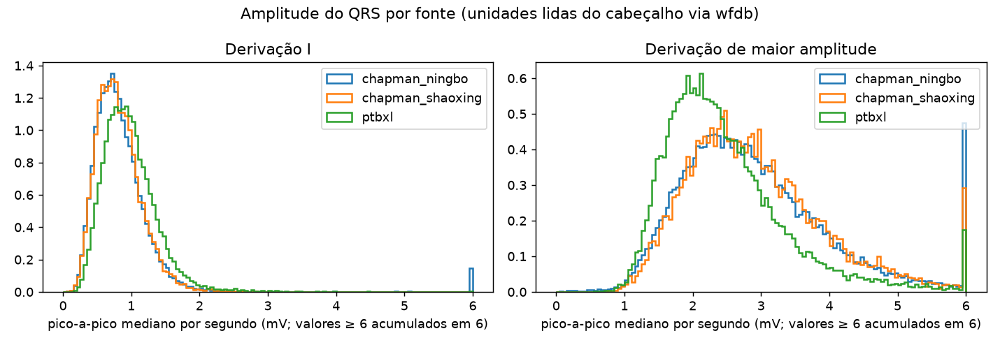

# Auditoria dos dados

> Documento gerado por `make audit` (`scripts/audit.py`). Não editar à mão: todos os números vêm de `results/audit/`. A interpretação está em `docs/decisions.md` e no texto marcado como *Leitura*.

## 1. Bases e versões

- **chapman** — A large scale 12-lead electrocardiogram database for arrhythmia study v1.0.0 — zip 2498709074 bytes, sha256 `2e4c5f2e89153c1acd2e418d4dec9a6b59881167ac07156061ccafadf5fce1d3`
- **ptbxl** — PTB-XL, a large publicly available electrocardiography dataset v1.0.3 — zip 1839504686 bytes, sha256 `2d98687a9c69c8df03dbd69e0c569b3363981a0f667861c279c747d4aec29812`

## 2. Contagem de exames por grupo de rótulo

Regras de agrupamento em `src/labels.py::assign_group` e `configs/default.yaml` (seção `labels`).

| grupo | chapman | ptbxl |
|---|---|---|
| AFIB | 1779 | 1477 |
| SINUS_NORMAL | 5908 | 6142 |
| SINUS_OUTRO | 1634 | 8915 |
| SINUS_BRADY | 14412 | 583 |
| SINUS_TACHY | 6165 | 643 |
| SINUS_ARRITMIA | 2308 | 617 |
| FORA_DE_TREINO | 12588 | 2769 |
| CONFLITO | 357 | 54 |
| SEM_RITMO | 1 | 599 |
| TOTAL | 45152 | 21799 |

Por fonte (a Chapman junta dois hospitais, ver 2.1):

| grupo | chapman_ningbo | chapman_shaoxing | ptbxl |
|---|---|---|---|
| AFIB | 0 | 1779 | 1477 |
| SINUS_NORMAL | 4542 | 1366 | 6142 |
| SINUS_OUTRO | 1251 | 383 | 8915 |
| SINUS_BRADY | 10834 | 3578 | 583 |
| SINUS_TACHY | 4823 | 1342 | 643 |
| SINUS_ARRITMIA | 2308 | 0 | 617 |
| FORA_DE_TREINO | 10793 | 1795 | 2769 |
| CONFLITO | 354 | 3 | 54 |
| SEM_RITMO | 0 | 1 | 599 |
| TOTAL | 34905 | 10247 | 21799 |

### 2.1 Duas fontes dentro da Chapman: Shaoxing e Ningbo

O cabeçalho não informa o hospital de origem. A fronteira foi inferida em JS10646: registros até ela = Chapman-Shaoxing (10247), depois = Ningbo (34905). Conferência: contagem de cada código SNOMED por fonte comparada com as colunas `Chapman_Shaoxing` e `Ningbo` das tabelas do PhysioNet/CinC Challenge 2021 (`results/audit/chapman_source_boundary_check.csv`). Códigos comparados: 94; com contagem idêntica nas duas fontes: 93; soma das diferenças absolutas: Shaoxing 1, Ningbo 0.

Códigos com diferença ou de ritmo relevante:

| codigo | abrev | dx | cinc_shaoxing | nosso_shaoxing | cinc_ningbo | nosso_ningbo | dif_shaoxing | dif_ningbo |
|---|---|---|---|---|---|---|---|---|
| 426177001 | SB | sinus bradycardia | 3889 | 3889 | 12670 | 12670 | 0 | 0 |
| 164889003 | AF | atrial fibrillation | 1780 | 1780 | 0 | 0 | 0 | 0 |
| 427084000 | STach | sinus tachycardia | 1568 | 1567 | 5687 | 5687 | -1 | 0 |
| 426761007 | SVT | supraventricular tachycardia | 587 | 587 | 137 | 137 | 0 | 0 |
| 164890007 | AFL | atrial flutter | 445 | 445 | 7615 | 7615 | 0 | 0 |
| 427393009 | SA | sinus arrhythmia | 0 | 0 | 2550 | 2550 | 0 | 0 |

### 2.2 Códigos fora do dicionário oficial da Chapman

13191 registros têm códigos que não constam de `ConditionNames_SNOMED-CT.csv`. Todos foram resolvidos pelas tabelas do CinC 2021 (dicionário complementar, commit fixado em `configs/default.yaml`). Quando o acrônimo coincide com um do dicionário oficial, o código oficial é diferente do usado nos cabeçalhos:

| codigo_no_cabecalho | abrev_cinc | descricao | n_registros | acronimo_oficial_mesmo_nome | codigo_no_dicionario_oficial |
|---|---|---|---|---|---|
| 55827005 | LVHV | left ventricular high voltage | 5401 |  |  |
| 55930002 | STC | s t changes | 4232 |  |  |
| 10370003 | PR | pacing rhythm | 1182 |  |  |
| 713427006 | CRBBB | complete right bundle branch block | 1096 |  |  |
| 427172004 | PVC | premature ventricular contractions | 1091 |  |  |
| 61721007 | CVCL/CCVCL | clockwise or counterclockwise vectorcardiographic loop | 653 |  |  |
| 365413008 | PRWP | poor R wave Progression | 638 |  |  |
| 6374002 | BBB | bundle branch block | 385 |  |  |
| 445118002 | LAnFB | left anterior fascicular block | 380 |  |  |
| 713426002 | IRBBB | incomplete right bundle branch block | 246 |  |  |
| 251223006 | TPW | tall p wave | 215 |  |  |
| 106068003 | ARH | atrial rhythm | 215 |  |  |
| 733534002 | CLBBB | complete left bundle branch block | 213 |  |  |
| 29320008 | AVJR | atrioventricular junctional rhythm | 139 |  |  |
| 425856008 | PVT | paroxysmal ventricular tachycardia | 109 |  |  |
| 251205003 | PPW | prolonged P wave | 106 |  |  |
| 81898007 | VEsR | ventricular escape rhythm | 96 |  |  |
| 251170000 | BPAC | blocked premature atrial contraction | 62 |  |  |
| 50799005 | AVD | atrioventricular dissociation | 59 |  |  |
| 164896001 | VF | ventricular fibrillation | 59 |  |  |
| 54329005 | AnMI | anterior myocardial infarction | 57 |  |  |
| 57054005 | AMI | acute myocardial infarction | 49 |  |  |
| 67751000119106 | RAHV | right atrial  high voltage | 36 |  |  |
| 5609005 | SARR | sinus arrest | 33 |  |  |
| 426648003 | JTach | junctional tachycardia | 24 |  |  |
| 49578007 | SPRI | shortened pr interval | 23 |  |  |
| 251187003 | AED | atrial escape beat | 17 |  |  |
| 251166008 | AVNRT | atrioventricular  node reentrant tachycardia | 16 | AVNRT | 233896004 |
| 233892002 | AAR | accelerated atrial escape rhythm | 16 |  |  |
| 61277005 | AIVR | accelerated idioventricular rhythm | 14 |  |  |
| 426664006 | AJR | accelerated junctional rhythm | 12 |  |  |
| 63593006 | SVPB | supraventricular premature beats | 9 |  |  |
| 446813000 | LAH | left atrial hypertrophy | 8 |  |  |
| 17366009 | SAAWR | sinus atrium to atrial wandering rhythm | 7 | SAAWR | 195101003 |
| 426627000 | Brady | bradycardia | 7 |  |  |
| 111288001 | VFL | ventricular flutter | 7 |  |  |
| 426183003 | IIAVBII | mobitz type II atrioventricular block | 7 |  |  |
| 251120003 | ILBBB | incomplete left bundle branch block | 6 |  |  |
| 65778007 | SAB | sinoatrial block | 5 |  |  |
| 445211001 | LPFB | left posterior fascicular block | 5 |  |  |
| 418818005 | BRU | brugada | 5 |  |  |
| 77867006 | SQT | decreased qt interval | 2 |  |  |
| 67741000119109 | LAE | left atrial enlargement | 1 |  |  |

### 2.3 Cobertura de ritmos ventriculares

| fonte | rotulo | n |
|---|---|---|
| chapman_ningbo | PVT | 109 |
| chapman_ningbo | VF | 59 |
| chapman_ningbo | VFL | 7 |
| chapman_ningbo | AIVR | 14 |
| chapman_ningbo | VEsR | 96 |

Enunciados de ritmo do PTB-XL (`scp_statements.csv`, `rhythm == 1`): AFIB, AFLT, BIGU, PACE, PSVT, SARRH, SBRAD, SR, STACH, SVARR, SVTAC, TRIGU. Nenhum é ventricular.

Detalhe de `FORA_DE_TREINO` e `CONFLITO` (top 15 por base):

| base | group | subtype | n |
|---|---|---|---|
| chapman | CONFLITO | AT+ST | 93 |
| chapman | CONFLITO | PR+SB | 50 |
| chapman | CONFLITO | PVT+ST | 19 |
| chapman | CONFLITO | AT+SB | 18 |
| chapman | CONFLITO | AF+SR | 16 |
| chapman | CONFLITO | PVT+SR | 13 |
| chapman | CONFLITO | AVJR+ST | 11 |
| chapman | CONFLITO | AVJR+SB | 10 |
| chapman | CONFLITO | PR+SA | 9 |
| chapman | CONFLITO | PR+SA+SB | 9 |
| chapman | CONFLITO | PR+ST | 9 |
| chapman | CONFLITO | AF+ST | 8 |
| chapman | CONFLITO | AT+SR | 8 |
| chapman | CONFLITO | ST+VEsR | 7 |
| chapman | CONFLITO | PR+SR | 6 |
| ptbxl | CONFLITO | AFIB+AFLT | 17 |
| ptbxl | CONFLITO | AFIB+1AVB | 9 |
| ptbxl | CONFLITO | AFLT+SR | 5 |
| ptbxl | CONFLITO | AFLT+STACH | 5 |
| ptbxl | CONFLITO | AFIB+PACE | 4 |
| ptbxl | CONFLITO | PACE+SR | 3 |
| ptbxl | CONFLITO | AFIB+3AVB | 2 |
| ptbxl | CONFLITO | PACE+SBRAD | 2 |
| ptbxl | CONFLITO | AFIB+2AVB | 1 |
| ptbxl | CONFLITO | AFIB+PSVT | 1 |
| ptbxl | CONFLITO | AFIB+SVTAC | 1 |
| ptbxl | CONFLITO | PSVT+SR | 1 |
| ptbxl | CONFLITO | PSVT+SR+SVTAC | 1 |
| ptbxl | CONFLITO | PSVT+STACH | 1 |
| ptbxl | CONFLITO | SR+SVTAC | 1 |

### Rótulos mais frequentes — chapman (top 25)

| rótulo | n |
|---|---|
| SB | 16559 |
| SR | 8125 |
| AF | 8060 |
| ST | 7254 |
| TWC | 7043 |
| LVHV | 5401 |
| STC | 4232 |
| TWO | 2877 |
| SA | 2550 |
| AFIB | 1780 |
| STDD | 1668 |
| ALS | 1545 |
| APB | 1312 |
| PR | 1182 |
| STTC | 1158 |
| 1AVB | 1140 |
| CRBBB | 1096 |
| PVC | 1091 |
| AQW | 1063 |
| LVQRSAL | 1043 |
| ARS | 853 |
| STE | 801 |
| IDC | 771 |
| IVB | 771 |
| SVT | 724 |

Rótulos que acompanham AFIB: TWC (617), STTC (434), LVHV (367), STDD (187), IVB (152), IDC (152), VPB (147), RBBB (143), ALS (107), LVQRSAL (73)

Coocorrência entre ritmos e modificadores — chapman (diagonal = total do rótulo; CSV completo em `results/audit/chapman_rhythm_cooccurrence.csv`):

| index | AFIB | SR | SB | ST | SA | AF | SVT | AT | AVRT | PR | ARH | AVJR | JTach | VEsR | PVT | VF | SARR | APB | VPB | VEB | VFW | JEB | PVC | BPAC | 1AVB | 2AVB | 2AVB1 | 3AVB | AVB | PRIE | AVD | WPW |
|---|---|---|---|---|---|---|---|---|---|---|---|---|---|---|---|---|---|---|---|---|---|---|---|---|---|---|---|---|---|---|---|---|
| AFIB | 1780 | 0 | 0 | 0 | 0 | 0 | 0 | 0 | 0 | 0 | 0 | 0 | 0 | 0 | 0 | 0 | 0 | 0 | 147 | 6 | 0 | 0 | 0 | 0 | 0 | 1 | 0 | 0 | 0 | 0 | 0 | 0 |
| SR | 0 | 8125 | 6 | 0 | 208 | 20 | 0 | 10 | 0 | 8 | 1 | 4 | 1 | 2 | 13 | 0 | 0 | 151 | 17 | 1 | 2 | 4 | 82 | 7 | 118 | 2 | 2 | 10 | 1 | 3 | 1 | 9 |
| SB | 0 | 6 | 16559 | 0 | 709 | 1 | 0 | 24 | 2 | 62 | 3 | 15 | 0 | 4 | 0 | 0 | 7 | 453 | 39 | 12 | 5 | 42 | 151 | 31 | 753 | 14 | 11 | 9 | 1 | 29 | 19 | 32 |
| ST | 0 | 0 | 0 | 7254 | 10 | 9 | 6 | 95 | 0 | 10 | 1 | 11 | 2 | 7 | 19 | 0 | 0 | 575 | 62 | 1 | 10 | 5 | 215 | 14 | 203 | 8 | 9 | 17 | 2 | 19 | 10 | 13 |
| SA | 0 | 208 | 709 | 10 | 2550 | 3 | 0 | 10 | 1 | 20 | 2 | 9 | 0 | 1 | 0 | 0 | 4 | 87 | 0 | 3 | 1 | 17 | 46 | 8 | 69 | 4 | 3 | 3 | 0 | 4 | 5 | 7 |
| AF | 0 | 20 | 1 | 9 | 3 | 8060 | 46 | 9 | 0 | 679 | 0 | 39 | 1 | 10 | 17 | 0 | 1 | 12 | 19 | 23 | 71 | 10 | 564 | 4 | 3 | 35 | 1 | 37 | 227 | 0 | 25 | 7 |
| SVT | 0 | 0 | 0 | 6 | 0 | 46 | 724 | 19 | 1 | 0 | 1 | 0 | 3 | 0 | 4 | 0 | 0 | 0 | 6 | 0 | 2 | 0 | 6 | 0 | 4 | 0 | 0 | 0 | 0 | 0 | 0 | 6 |
| AT | 0 | 10 | 24 | 95 | 10 | 9 | 19 | 297 | 0 | 5 | 3 | 0 | 1 | 0 | 2 | 0 | 0 | 118 | 4 | 0 | 2 | 4 | 11 | 3 | 18 | 4 | 4 | 0 | 13 | 0 | 2 | 1 |
| AVRT | 0 | 0 | 2 | 0 | 1 | 0 | 1 | 0 | 26 | 6 | 0 | 6 | 0 | 1 | 3 | 0 | 0 | 1 | 0 | 0 | 1 | 1 | 1 | 0 | 0 | 1 | 0 | 0 | 0 | 0 | 0 | 1 |
| PR | 0 | 8 | 62 | 10 | 20 | 679 | 0 | 5 | 6 | 1182 | 3 | 3 | 0 | 4 | 4 | 1 | 7 | 26 | 0 | 1 | 87 | 0 | 69 | 0 | 44 | 4 | 2 | 10 | 2 | 1 | 25 | 0 |
| ARH | 0 | 1 | 3 | 1 | 2 | 0 | 1 | 3 | 0 | 3 | 215 | 0 | 0 | 0 | 0 | 0 | 0 | 17 | 0 | 0 | 0 | 2 | 7 | 1 | 8 | 0 | 2 | 0 | 0 | 0 | 0 | 1 |
| AVJR | 0 | 4 | 15 | 11 | 9 | 39 | 0 | 0 | 6 | 3 | 0 | 139 | 0 | 6 | 0 | 0 | 5 | 5 | 0 | 0 | 1 | 0 | 10 | 1 | 2 | 9 | 0 | 46 | 0 | 0 | 14 | 0 |
| JTach | 0 | 1 | 0 | 2 | 0 | 1 | 3 | 1 | 0 | 0 | 0 | 0 | 24 | 0 | 0 | 0 | 0 | 5 | 0 | 0 | 0 | 0 | 0 | 0 | 0 | 0 | 0 | 0 | 0 | 0 | 1 | 0 |
| VEsR | 0 | 2 | 4 | 7 | 1 | 10 | 0 | 0 | 1 | 4 | 0 | 6 | 0 | 96 | 0 | 0 | 5 | 0 | 0 | 1 | 0 | 0 | 10 | 0 | 0 | 5 | 0 | 14 | 0 | 0 | 1 | 0 |
| PVT | 0 | 13 | 0 | 19 | 0 | 17 | 4 | 2 | 3 | 4 | 0 | 0 | 0 | 0 | 109 | 0 | 1 | 6 | 0 | 0 | 7 | 0 | 26 | 0 | 1 | 0 | 0 | 0 | 0 | 0 | 9 | 2 |
| VF | 0 | 0 | 0 | 0 | 0 | 0 | 0 | 0 | 0 | 1 | 0 | 0 | 0 | 0 | 0 | 59 | 0 | 0 | 0 | 0 | 0 | 0 | 0 | 0 | 0 | 0 | 0 | 0 | 0 | 0 | 0 | 0 |
| SARR | 0 | 0 | 7 | 0 | 4 | 1 | 0 | 0 | 0 | 7 | 0 | 5 | 0 | 5 | 1 | 0 | 33 | 0 | 0 | 7 | 2 | 7 | 2 | 0 | 3 | 0 | 0 | 0 | 0 | 0 | 0 | 0 |
| APB | 0 | 151 | 453 | 575 | 87 | 12 | 0 | 118 | 1 | 26 | 17 | 5 | 5 | 0 | 6 | 0 | 0 | 1312 | 13 | 6 | 3 | 24 | 76 | 30 | 91 | 1 | 2 | 3 | 0 | 1 | 2 | 2 |
| VPB | 147 | 17 | 39 | 62 | 0 | 19 | 6 | 4 | 0 | 0 | 0 | 0 | 0 | 0 | 0 | 0 | 0 | 13 | 294 | 0 | 1 | 2 | 0 | 0 | 5 | 0 | 0 | 0 | 6 | 0 | 0 | 0 |
| VEB | 6 | 1 | 12 | 1 | 3 | 23 | 0 | 0 | 0 | 1 | 0 | 0 | 0 | 1 | 0 | 0 | 7 | 6 | 0 | 56 | 1 | 2 | 9 | 0 | 5 | 1 | 1 | 1 | 0 | 1 | 1 | 0 |
| VFW | 0 | 2 | 5 | 10 | 1 | 71 | 2 | 2 | 1 | 87 | 0 | 1 | 0 | 0 | 7 | 0 | 2 | 3 | 1 | 1 | 116 | 0 | 12 | 0 | 2 | 0 | 0 | 0 | 1 | 0 | 3 | 0 |
| JEB | 0 | 4 | 42 | 5 | 17 | 10 | 0 | 4 | 1 | 0 | 2 | 0 | 0 | 0 | 0 | 0 | 7 | 24 | 2 | 2 | 0 | 75 | 7 | 5 | 9 | 9 | 3 | 6 | 1 | 0 | 6 | 0 |
| PVC | 0 | 82 | 151 | 215 | 46 | 564 | 6 | 11 | 1 | 69 | 7 | 10 | 0 | 10 | 26 | 0 | 2 | 76 | 0 | 9 | 12 | 7 | 1091 | 4 | 39 | 5 | 2 | 8 | 1 | 1 | 2 | 3 |
| BPAC | 0 | 7 | 31 | 14 | 8 | 4 | 0 | 3 | 0 | 0 | 1 | 1 | 0 | 0 | 0 | 0 | 0 | 30 | 0 | 0 | 0 | 5 | 4 | 62 | 10 | 1 | 2 | 0 | 0 | 0 | 1 | 0 |
| 1AVB | 0 | 118 | 753 | 203 | 69 | 3 | 4 | 18 | 0 | 44 | 8 | 2 | 0 | 0 | 1 | 0 | 3 | 91 | 5 | 5 | 2 | 9 | 39 | 10 | 1140 | 3 | 3 | 0 | 1 | 0 | 5 | 0 |
| 2AVB | 1 | 2 | 14 | 8 | 4 | 35 | 0 | 4 | 1 | 4 | 0 | 9 | 0 | 5 | 0 | 0 | 0 | 1 | 0 | 1 | 0 | 9 | 5 | 1 | 3 | 66 | 0 | 0 | 2 | 1 | 1 | 0 |
| 2AVB1 | 0 | 2 | 11 | 9 | 3 | 1 | 0 | 4 | 0 | 2 | 2 | 0 | 0 | 0 | 0 | 0 | 0 | 2 | 0 | 1 | 0 | 3 | 2 | 2 | 3 | 0 | 31 | 0 | 0 | 4 | 0 | 0 |
| 3AVB | 0 | 10 | 9 | 17 | 3 | 37 | 0 | 0 | 0 | 10 | 0 | 46 | 0 | 14 | 0 | 0 | 0 | 3 | 0 | 1 | 0 | 6 | 8 | 0 | 0 | 0 | 0 | 76 | 0 | 0 | 3 | 0 |
| AVB | 0 | 1 | 1 | 2 | 0 | 227 | 0 | 13 | 0 | 2 | 0 | 0 | 0 | 0 | 0 | 0 | 0 | 0 | 6 | 0 | 1 | 1 | 1 | 0 | 1 | 2 | 0 | 0 | 244 | 0 | 0 | 0 |
| PRIE | 0 | 3 | 29 | 19 | 4 | 0 | 0 | 0 | 0 | 1 | 0 | 0 | 0 | 0 | 0 | 0 | 0 | 1 | 0 | 1 | 0 | 0 | 1 | 0 | 0 | 1 | 4 | 0 | 0 | 52 | 0 | 0 |
| AVD | 0 | 1 | 19 | 10 | 5 | 25 | 0 | 2 | 0 | 25 | 0 | 14 | 1 | 1 | 9 | 0 | 0 | 2 | 0 | 1 | 3 | 6 | 2 | 1 | 5 | 1 | 0 | 3 | 0 | 0 | 59 | 0 |
| WPW | 0 | 9 | 32 | 13 | 7 | 7 | 6 | 1 | 1 | 0 | 1 | 0 | 0 | 0 | 2 | 0 | 0 | 2 | 0 | 0 | 0 | 0 | 3 | 0 | 0 | 0 | 0 | 0 | 0 | 0 | 0 | 72 |

### Rótulos mais frequentes — ptbxl (top 25)

| rótulo | n |
|---|---|
| SR | 16748 |
| NORM | 9514 |
| ABQRS | 3327 |
| IMI | 2676 |
| ASMI | 2357 |
| LVH | 2132 |
| NDT | 1825 |
| LAFB | 1623 |
| AFIB | 1514 |
| ISC_ | 1272 |
| PVC | 1143 |
| IRBBB | 1118 |
| STD_ | 1009 |
| VCLVH | 875 |
| STACH | 826 |
| 1AVB | 793 |
| IVCD | 787 |
| SARRH | 772 |
| NST_ | 767 |
| ISCAL | 659 |
| SBRAD | 637 |
| QWAVE | 548 |
| CRBBB | 541 |
| CLBBB | 536 |
| ILMI | 478 |

Rótulos que acompanham AFIB: ASMI (368), ABQRS (312), LVH (275), ISC_ (257), IMI (251), NST_ (217), STD_ (210), PVC (205), NDT (198), ISCAL (145)

Coocorrência entre ritmos e modificadores — ptbxl (diagonal = total do rótulo; CSV completo em `results/audit/ptbxl_rhythm_cooccurrence.csv`):

| index | AFIB | SR | SBRAD | STACH | SARRH | AFLT | SVTAC | PSVT | SVARR | PACE | PVC | PAC | BIGU | TRIGU | 1AVB | LPR | WPW |
|---|---|---|---|---|---|---|---|---|---|---|---|---|---|---|---|---|---|
| AFIB | 1514 | 0 | 0 | 0 | 0 | 17 | 1 | 1 | 0 | 4 | 205 | 3 | 7 | 0 | 9 | 0 | 2 |
| SR | 0 | 16748 | 0 | 0 | 2 | 5 | 2 | 2 | 0 | 3 | 587 | 332 | 37 | 11 | 602 | 310 | 65 |
| SBRAD | 0 | 0 | 637 | 0 | 3 | 0 | 0 | 0 | 0 | 2 | 4 | 9 | 3 | 0 | 26 | 8 | 3 |
| STACH | 0 | 0 | 0 | 826 | 0 | 5 | 0 | 1 | 0 | 0 | 90 | 41 | 11 | 4 | 54 | 13 | 0 |
| SARRH | 0 | 2 | 3 | 0 | 772 | 0 | 0 | 0 | 0 | 0 | 119 | 7 | 2 | 0 | 27 | 5 | 3 |
| AFLT | 17 | 5 | 0 | 5 | 0 | 73 | 6 | 0 | 4 | 0 | 1 | 0 | 0 | 0 | 3 | 1 | 0 |
| SVTAC | 1 | 2 | 0 | 0 | 0 | 6 | 27 | 9 | 0 | 0 | 5 | 0 | 0 | 0 | 2 | 0 | 0 |
| PSVT | 1 | 2 | 0 | 1 | 0 | 0 | 9 | 24 | 2 | 0 | 2 | 0 | 0 | 0 | 0 | 0 | 0 |
| SVARR | 0 | 0 | 0 | 0 | 0 | 4 | 0 | 2 | 157 | 0 | 9 | 0 | 0 | 1 | 15 | 0 | 5 |
| PACE | 4 | 3 | 2 | 0 | 0 | 0 | 0 | 0 | 0 | 294 | 1 | 1 | 0 | 0 | 0 | 0 | 0 |
| PVC | 205 | 587 | 4 | 90 | 119 | 1 | 5 | 2 | 9 | 1 | 1143 | 57 | 41 | 7 | 84 | 35 | 0 |
| PAC | 3 | 332 | 9 | 41 | 7 | 0 | 0 | 0 | 0 | 1 | 57 | 398 | 21 | 5 | 11 | 24 | 0 |
| BIGU | 7 | 37 | 3 | 11 | 2 | 0 | 0 | 0 | 0 | 0 | 41 | 21 | 82 | 0 | 4 | 1 | 0 |
| TRIGU | 0 | 11 | 0 | 4 | 0 | 0 | 0 | 0 | 1 | 0 | 7 | 5 | 0 | 20 | 0 | 2 | 0 |
| 1AVB | 9 | 602 | 26 | 54 | 27 | 3 | 2 | 0 | 15 | 0 | 84 | 11 | 4 | 0 | 793 | 125 | 0 |
| LPR | 0 | 310 | 8 | 13 | 5 | 1 | 0 | 0 | 0 | 0 | 35 | 24 | 1 | 2 | 125 | 340 | 0 |
| WPW | 2 | 65 | 3 | 0 | 3 | 0 | 0 | 0 | 5 | 0 | 0 | 0 | 0 | 0 | 0 | 0 | 79 |

## 3. Integridade do sinal

| verificação | chapman | ptbxl |
|---|---|---|
| registros no índice | 45152 | 21799 |
| cabeçalho ilegível | 1 | 0 |
| sinal ilegível | 2 | 0 |
| sem derivação I | 0 | 0 |
| n_amostras != 5000 | 0 | 0 |
| NaN em alguma derivação | 0 | 0 |
| NaN na derivação I | 0 | 0 |
| derivação I plana | 1 | 0 |
| ≥1 derivação plana | 1495 | 1 |
| derivação I com >50% de zeros | 1 | 0 |
| código de rótulo desconhecido | 0 | 0 |
| sem idade | 303 | 0 |
| sem sexo | 23 | 0 |

- **chapman**: fs = {500.0: 45150}; n_amostras = {5000.0: 45150}; unidades = {'mV': 45150}; ganho A/D = {'1000': 45150}; resolução A/D (bits) = {'16': 45150}
  - erros de leitura: {"ValueError: time data '/' does not match format '%d/%m/%Y'": 1, 'IndexError: list index out of range': 1}
  - registros com sinal inválido por grupo: {'FORA_DE_TREINO': 2, 'SEM_RITMO': 1} (lista em `results/audit/chapman_invalid_records.csv`)
- **ptbxl**: fs = {500: 21799}; n_amostras = {5000: 21799}; unidades = {'mV': 21799}; ganho A/D = {'1000': 21799}; resolução A/D (bits) = {'16': 21799}
  - registros com sinal inválido por grupo: {} (lista em `results/audit/ptbxl_invalid_records.csv`)

PTB-XL — anotações de qualidade do próprio PTB-XL (registros com o campo preenchido):

| grupo | baseline_drift | static_noise | burst_noise | electrodes_problems | extra_beats | pacemaker | n |
|---|---|---|---|---|---|---|---|
| AFIB | 90 | 256 | 116 | 1 | 243 | 0 | 1477 |
| SINUS_NORMAL | 518 | 873 | 132 | 6 | 122 | 2 | 6142 |
| SINUS_OUTRO | 604 | 1434 | 213 | 9 | 400 | 2 | 8915 |
| SINUS_BRADY | 32 | 75 | 12 | 0 | 18 | 0 | 583 |
| SINUS_TACHY | 64 | 81 | 13 | 2 | 46 | 0 | 643 |
| SINUS_ARRITMIA | 63 | 110 | 24 | 2 | 31 | 0 | 617 |
| FORA_DE_TREINO | 170 | 371 | 88 | 7 | 1015 | 282 | 2769 |
| CONFLITO | 2 | 11 | 6 | 0 | 17 | 5 | 54 |
| SEM_RITMO | 55 | 49 | 9 | 3 | 57 | 0 | 599 |

`validated_by_human`: {True: 16056, False: 5743}

## 4. Unidades e amplitude do QRS

Pico-a-pico mediano por janela de 1 s após passa-alta de 0,5 Hz, em mV, com a conversão lida do cabeçalho (ganho e baseline via `wfdb`). Registros com sinal inválido excluídos.

| base | medida | n | p1 | p5 | p25 | p50 | p75 | p95 | p99 |
|---|---|---|---|---|---|---|---|---|---|
| chapman_ningbo | qrs_p2p_leadI_mv | 34903 | 0.26 | 0.37 | 0.58 | 0.77 | 1.01 | 1.47 | 2.47 |
| chapman_ningbo | qrs_p2p_maxlead_mv | 34903 | 1.11 | 1.47 | 2.13 | 2.72 | 3.45 | 5.00 | 7.95 |
| chapman_ningbo | qrs_p2p_leadI_mv [SINUS_NORMAL] | 4542 | 0.29 | 0.40 | 0.60 | 0.77 | 0.98 | 1.33 | 1.61 |
| chapman_ningbo | qrs_p2p_leadI_mv [SINUS_BRADY] | 10834 | 0.28 | 0.38 | 0.58 | 0.77 | 0.99 | 1.37 | 1.72 |
| chapman_ningbo | qrs_p2p_leadI_mv [SINUS_TACHY] | 4823 | 0.27 | 0.36 | 0.59 | 0.82 | 1.09 | 1.59 | 2.07 |
| chapman_shaoxing | qrs_p2p_leadI_mv | 10246 | 0.27 | 0.37 | 0.58 | 0.77 | 1.00 | 1.40 | 1.78 |
| chapman_shaoxing | qrs_p2p_maxlead_mv | 10246 | 1.23 | 1.55 | 2.19 | 2.76 | 3.46 | 4.84 | 6.29 |
| chapman_shaoxing | qrs_p2p_leadI_mv [AFIB] | 1779 | 0.24 | 0.34 | 0.52 | 0.71 | 0.93 | 1.33 | 1.76 |
| chapman_shaoxing | qrs_p2p_leadI_mv [SINUS_NORMAL] | 1366 | 0.29 | 0.39 | 0.58 | 0.76 | 0.98 | 1.33 | 1.55 |
| chapman_shaoxing | qrs_p2p_leadI_mv [SINUS_BRADY] | 3578 | 0.28 | 0.38 | 0.58 | 0.76 | 0.99 | 1.40 | 1.75 |
| chapman_shaoxing | qrs_p2p_leadI_mv [SINUS_TACHY] | 1342 | 0.28 | 0.39 | 0.61 | 0.83 | 1.04 | 1.49 | 1.81 |
| ptbxl | qrs_p2p_leadI_mv | 21799 | 0.33 | 0.46 | 0.70 | 0.92 | 1.18 | 1.65 | 2.34 |
| ptbxl | qrs_p2p_maxlead_mv | 21799 | 1.13 | 1.38 | 1.85 | 2.29 | 2.87 | 4.21 | 5.79 |
| ptbxl | qrs_p2p_leadI_mv [AFIB] | 1477 | 0.25 | 0.38 | 0.63 | 0.83 | 1.07 | 1.54 | 2.03 |
| ptbxl | qrs_p2p_leadI_mv [SINUS_NORMAL] | 6142 | 0.35 | 0.45 | 0.67 | 0.86 | 1.08 | 1.41 | 1.66 |
| ptbxl | qrs_p2p_leadI_mv [SINUS_BRADY] | 583 | 0.27 | 0.40 | 0.66 | 0.86 | 1.10 | 1.53 | 1.99 |
| ptbxl | qrs_p2p_leadI_mv [SINUS_TACHY] | 643 | 0.31 | 0.43 | 0.66 | 0.89 | 1.14 | 1.58 | 1.94 |

## 5. Idade e sexo por grupo e base

PTB-XL codifica idade acima de 89 anos como 300 (anonimização): 293 registros, tratados como 90 (= "≥ 90") em todas as estatísticas abaixo.

Ningbo: 247 registros com idade 0 e 0 com 1 a 3 anos; o 0 é tratado como idade ausente (`src.data.clean_age`).

| base | grupo | n | idade_mediana | idade_p25 | idade_p75 | pct_F | pct_30_55anos |
|---|---|---|---|---|---|---|---|
| chapman_ningbo | SINUS_NORMAL | 4542 | 52 | 40 | 63 | 57.4 | 47.8 |
| chapman_ningbo | SINUS_OUTRO | 1251 | 61 | 51 | 70 | 50.9 | 32.2 |
| chapman_ningbo | SINUS_BRADY | 10834 | 59 | 50 | 67 | 37.6 | 38.0 |
| chapman_ningbo | SINUS_TACHY | 4823 | 50 | 26 | 66 | 49.9 | 30.9 |
| chapman_ningbo | SINUS_ARRITMIA | 2308 | 30 | 15 | 53 | 43.3 | 28.4 |
| chapman_ningbo | FORA_DE_TREINO | 10793 | 73 | 65 | 81 | 39.6 | 10.5 |
| chapman_ningbo | CONFLITO | 354 | 73 | 65 | 82 | 46.9 | 11.9 |
| chapman_shaoxing | AFIB | 1779 | 75 | 67 | 82 | 41.5 | 8.2 |
| chapman_shaoxing | SINUS_NORMAL | 1366 | 53 | 41 | 64 | 58.0 | 48.2 |
| chapman_shaoxing | SINUS_OUTRO | 383 | 61 | 50 | 70 | 52.2 | 33.2 |
| chapman_shaoxing | SINUS_BRADY | 3578 | 59 | 50 | 67 | 36.9 | 36.9 |
| chapman_shaoxing | SINUS_TACHY | 1342 | 54 | 38 | 68 | 50.2 | 35.7 |
| chapman_shaoxing | FORA_DE_TREINO | 1795 | 67 | 54 | 78 | 43.9 | 22.5 |
| chapman_shaoxing | CONFLITO | 3 | 74 | 52.5 | 78.5 | 0 | 33.3 |
| chapman_shaoxing | SEM_RITMO | 1 |  |  |  | 0 | 0 |
| ptbxl | AFIB | 1477 | 72 | 63 | 81 | 44.7 | 10.6 |
| ptbxl | SINUS_NORMAL | 6142 | 52 | 39 | 63 | 56.1 | 45.7 |
| ptbxl | SINUS_OUTRO | 8915 | 63 | 54 | 72 | 44.3 | 26.5 |
| ptbxl | SINUS_BRADY | 583 | 57 | 46 | 67.5 | 38.8 | 36.7 |
| ptbxl | SINUS_TACHY | 643 | 64 | 50.5 | 75 | 58.0 | 28.1 |
| ptbxl | SINUS_ARRITMIA | 617 | 43 | 26 | 66 | 54.3 | 30.8 |
| ptbxl | FORA_DE_TREINO | 2769 | 70 | 61 | 79 | 43.4 | 13.4 |
| ptbxl | CONFLITO | 54 | 70 | 60.8 | 80.8 | 29.6 | 16.7 |
| ptbxl | SEM_RITMO | 599 | 67 | 58 | 77 | 39.4 | 17.9 |

Faixas etárias (grupos usados no modelo):

| faixa | base | SINUS_BRADY | SINUS_NORMAL | SINUS_OUTRO | SINUS_TACHY | AFIB |
|---|---|---|---|---|---|---|
| <18 | chapman_ningbo | 53 | 148 | 9 | 750 |  |
| 18-29 | chapman_ningbo | 342 | 370 | 45 | 647 |  |
| 30-39 | chapman_ningbo | 621 | 523 | 76 | 450 |  |
| 40-49 | chapman_ningbo | 1658 | 904 | 133 | 560 |  |
| 50-59 | chapman_ningbo | 2846 | 1070 | 271 | 730 |  |
| 60-69 | chapman_ningbo | 3297 | 890 | 327 | 742 |  |
| 70-79 | chapman_ningbo | 1513 | 412 | 225 | 528 |  |
| 80+ | chapman_ningbo | 488 | 138 | 117 | 410 |  |
| <18 | chapman_shaoxing | 18 | 20 | 3 | 83 | 0 |
| 18-29 | chapman_shaoxing | 130 | 110 | 14 | 139 | 0 |
| 30-39 | chapman_shaoxing | 227 | 180 | 24 | 137 | 8 |
| 40-49 | chapman_shaoxing | 506 | 253 | 47 | 185 | 52 |
| 50-59 | chapman_shaoxing | 955 | 333 | 90 | 236 | 140 |
| 60-69 | chapman_shaoxing | 1109 | 287 | 101 | 271 | 395 |
| 70-79 | chapman_shaoxing | 473 | 144 | 66 | 174 | 575 |
| 80+ | chapman_shaoxing | 160 | 39 | 38 | 117 | 609 |
| <18 | ptbxl | 5 | 67 | 16 | 5 | 1 |
| 18-29 | ptbxl | 39 | 727 | 209 | 33 | 12 |
| 30-39 | ptbxl | 53 | 785 | 390 | 37 | 6 |
| 40-49 | ptbxl | 80 | 1126 | 880 | 80 | 53 |
| 50-59 | ptbxl | 146 | 1453 | 2031 | 108 | 199 |
| 60-69 | ptbxl | 135 | 1134 | 2508 | 148 | 337 |
| 70-79 | ptbxl | 86 | 623 | 1845 | 115 | 431 |
| 80+ | ptbxl | 39 | 227 | 1036 | 117 | 438 |

Idade máxima: chapman = 89 (0 registros ≥ 90), ptbxl = 90 (293 registros ≥ 90)

## 6. Identificação de paciente

- **chapman**: tem_id_paciente = False; campos_do_cabecalho = ['Age,Dx,Hx,Rx,Sex,Sx', '']
- **ptbxl**: tem_id_paciente = True; n_pacientes = 18869; registros_por_paciente_max = 10; pacientes_com_>1_registro = 2111; registros_de_pacientes_com_>1 = 5041; pacientes_com_>1_grupo_de_ritmo = 479; pacientes_em_>1_strat_fold = 0

## 7. Duplicatas de sinal (hash SHA-1 das amostras digitais)

- **chapman:hash_all**: grupos_duplicados = 87; registros_envolvidos = 174; grupos_com_rotulos_diferentes = 12; pares_entre_fontes = 71; grupos_mesma_idade_e_sexo = 85; grupos_com_AFIB = 14; combinacoes_de_rotulo_divergentes = {'AFIB vs FORA_DE_TREINO': 12}
- **chapman:hash_leadI**: grupos_duplicados = 87; registros_envolvidos = 174; grupos_com_rotulos_diferentes = 12
- **ptbxl:hash_all**: grupos_duplicados = 0; registros_envolvidos = 0; grupos_com_rotulos_diferentes = 0
- **ptbxl:hash_leadI**: grupos_duplicados = 0; registros_envolvidos = 0; grupos_com_rotulos_diferentes = 0
- **entre_bases:hash_leadI**: grupos_duplicados = 0

Ritmo primário das cópias idênticas Shaoxing ↔ Ningbo (mesmo sinal digital, rótulo de cada fonte):

| ritmo_shaoxing | ritmo_ningbo | pares |
|---|---|---|
| SVT | PVT | 20 |
| SR | SR | 17 |
| AFIB | AF | 12 |
| SB | SB | 10 |
| SVT | SVT | 5 |
| ST | ST | 4 |
| AF | AF | 1 |
| SVT | PVT+SVT | 1 |
| AVRT | SVT | 1 |

Registros com ≥ 1 derivação plana (qualquer derivação), por fonte da Chapman: {'ningbo': 1480, 'shaoxing': 15}

## 8. Volume para o desenho experimental

Contagens após excluir registros com sinal inválido.

- `chapman_shaoxing_afib` = 1779
- `chapman_shaoxing_sinus_normal` = 1366
- `chapman_shaoxing_sinus_outro` = 383
- `chapman_shaoxing_sinus_brady` = 3578
- `chapman_shaoxing_sinus_tachy` = 1342
- `chapman_shaoxing_sinus_arritmia` = 0
- `chapman_ningbo_afib` = 0
- `chapman_ningbo_sinus_normal` = 4542
- `chapman_ningbo_sinus_outro` = 1251
- `chapman_ningbo_sinus_brady` = 10834
- `chapman_ningbo_sinus_tachy` = 4823
- `chapman_ningbo_sinus_arritmia` = 2308
- `chapman_afib_validos` = 1779
- `chapman_sinusal_validos` = 28119
- `chapman_afib_teste_15pct_aprox` = 267
- `ptbxl_afib_folds_1_8` = 1181
- `ptbxl_sinus_normal_folds_1_8` = 4967
- `ptbxl_afib_fold_9` = 148
- `ptbxl_sinus_normal_fold_9` = 587
- `ptbxl_afib_fold_10` = 148
- `ptbxl_sinus_normal_fold_10` = 588
- `ptbxl_afib_total` = 1477
- `ptbxl_sinus_normal_total` = 6142
- `ptbxl_sinus_brady_total` = 583
- `ptbxl_sinus_tachy_total` = 643
- `ptbxl_flutter_total` = 73
- `chapman_flutter_total` = 8060

## 9. Leitura da auditoria

*Texto interpretativo mantido à mão. Os números citados estão nas seções acima, geradas de `results/audit/`.*

1. **A Chapman são duas bases.** Os registros até JS10646 vêm de Chapman-Shaoxing e os seguintes de Ningbo
   (seção 2.1). A fronteira foi inferida pela mudança de vocabulário e conferida contra as contagens por fonte
   publicadas pelo CinC 2021, com 93 de 94 códigos idênticos. **Toda a AFIB está em Shaoxing**: Ningbo tem zero.
   Misturar os sinusais de Ningbo com a AFIB de Shaoxing repetiria o problema central do TCC (fonte ≡ rótulo).
2. **O "flutter atrial" de Ningbo não é confiável.** Os 12 sinais idênticos que Shaoxing rotula como AFIB
   aparecem em Ningbo com o código de flutter (seção 7). Isso é compatível com "AF" (fibrilação, no uso
   comum) ter sido convertido para o código SNOMED de flutter. É uma hipótese: não há laudo para confirmar.
   Os ~7,6 mil "flutter" de Ningbo ficam fora das análises principais.
3. **Ritmos ventriculares: sem cobertura utilizável.** PTB-XL não tem nenhum enunciado de ritmo ventricular.
   Os rótulos de TV/FV de Ningbo vêm só do dicionário complementar, e 21 dos 26 sinais de SVT de Shaoxing
   duplicados em Ningbo receberam "TV paroxística". Esses rótulos não sustentam nenhuma afirmação sobre
   detecção de TV/FV.
4. **O dicionário oficial da Chapman está incompleto e tem erros.** 29% dos registros usam códigos ausentes
   dele, e dois acrônimos (AVNRT, SAAWR) aparecem nos cabeçalhos com códigos diferentes dos do dicionário.
   Sem o dicionário complementar, registros com marcapasso, ritmo juncional ou bloqueio de ramo cairiam como
   "sinusal normal".
5. **Unidades corretas.** Ganho 1000/mV em todos os registros de ambas as bases. A amplitude mediana do QRS na
   derivação I fica em 0,77 mV (Chapman) e 0,92 mV (PTB-XL), valores plausíveis. A interpretação de
   4,88 µV/bit daria medianas acima de 3 mV na derivação I, implausíveis. Há diferença de escala entre bases
   (~20%), absorvida pela normalização por janela.
6. **Integridade do sinal boa.** Apenas 3 registros inválidos (Chapman), nenhum NaN e todos com 5.000 amostras.
   Derivações planas aparecem em 1.495 registros da Chapman, quase todos de Ningbo, mas a derivação I é plana
   em só 1.
7. **Duplicatas.** São 87 pares exatos na Chapman: 71 entre Shaoxing e Ningbo e 13 dentro de Shaoxing.
   Nenhuma no PTB-XL nem entre bases. Precisam ser removidas antes de dividir treino e teste, senão há
   vazamento.
8. **Paciente.** A Chapman não tem identificador de paciente, então a divisão de Shaoxing é por registro
   (limitação declarada). O PTB-XL tem `patient_id`, e nenhum paciente aparece em mais de uma `strat_fold`.
9. **Idade é um confundidor forte.** A AFIB tem mediana de 72–75 anos, contra 52–64 nos grupos sinusais. Só 8–11% da
   AFIB está na faixa de 30 a 55 anos, então os subgrupos "idade de astronauta" terão intervalos largos.
10. **Volume suficiente: o desenho continua viável**, com o ajuste do item 1. Shaoxing tem 1.779 AFIB e 6.669
    sinusais (normal + outro + bradi + taqui) para o experimento A. O PTB-XL tem 1.477 AFIB para a validação
    externa (experimento B), bem acima do mínimo para intervalos de confiança úteis. O sentido inverso também
    é viável: treinar no PTB-XL (folds 1–8: 1.181 AFIB) e testar em Shaoxing.
