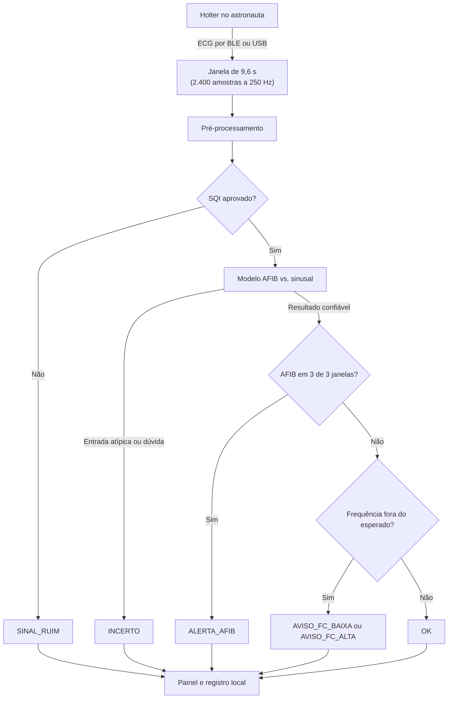

# Dispositivo físico: plataforma-alvo e requisitos

> **Estado:** proposta de arquitetura. Nenhum hardware foi integrado ou medido até agora.
> Protótipo de pesquisa, não é dispositivo médico nem hardware de voo.
>
> Os números do modelo foram transcritos de `results/benchmark/` e do `HANDOFF.md` (commit `50cef09`).
> Se os resultados forem regenerados, a fonte de verdade é `results/`.

## Resumo

- **Plataforma-alvo:** Raspberry Pi 4 Model B, com 2 GB de RAM ou 4 GB, se o preço estiver próximo.
- **Sensor:** Holter ou monitor de ECG que envie o sinal em tempo real, por BLE ou USB.
- **Função:** analisar o ECG a bordo e avisar a tripulação, sem depender de comunicação com a Terra.

## Como funciona

O diagrama simplifica a lógica. A ordem exata das regras está em `src/decision.py`.

| Etapa | O que acontece |
|---|---|
| Captura | O Holter registra o ECG e envia as amostras ao Pi. |
| Janela | O Pi acumula 2.400 amostras, cerca de 9,6 s de sinal. |
| Pré-processamento | Notch de 50 Hz, Butterworth de 0,05–30 Hz e normalização robusta por janela. |
| Qualidade do sinal | Janela reprovada retorna `SINAL_RUIM` e não gera aviso clínico. |
| Modelo | Regressão logística com 30 atributos estima a probabilidade de fibrilação atrial (AFIB). |
| Votação | `ALERTA_AFIB` exige AFIB em 3 janelas consecutivas, cerca de 29 s de sinal. |
| Frequência | Desvios geram aviso leve, com limiares de 60/100 bpm adaptados ao histórico da pessoa. |
| Saída | O estado aparece no painel e fica registrado localmente. |

## Por que o Raspberry Pi 4

| Critério | Raspberry Pi 4 Model B |
|---|---|
| Conexão com o sensor | Bluetooth 5.0 com BLE, USB 2.0 e 3.0 |
| Processador | Cortex-A72 de quatro núcleos e 64 bits, de 1,5 a 1,8 GHz conforme a revisão |
| Memória | Versões de 1, 2, 3, 4 e 8 GB |
| Temperatura de operação | 0–50 °C |
| Alimentação | 5 V, mínimo de 3 A |
| Disponibilidade | Produção prevista até pelo menos janeiro de 2034 |

### Compatibilidade com a V1

| Medida | Valor | Observação |
|---|---|---|
| Pipeline completo | 3,6 ms por janela (p95 de 4,2 ms) | Notebook i7, 1 thread |
| Só o modelo | 0,05 ms | Mesma máquina |
| Memória (RSS) | ~104 MB | Mesma máquina |
| Artefatos | JSON de 34 KB; ONNX de 0,8 KB | |
| Tempo disponível | 9,6 s por janela, se não houver sobreposição | Margem esperada, ainda não medida no Pi |

**Precedente em órbita:** as unidades [Astro Pi Mark II](https://www.esa.int/Education/AstroPI/New_Astro_Pi_computers_speeding_their_way_into_space), levadas à Estação Espacial Internacional em 2021, usam o Raspberry Pi 4. Elas passaram por certificação e voam em caixa própria, então isso mostra que a família é viável como base, não que uma placa comum esteja pronta para voo.

## Opções consideradas

| Placa | Avaliação | Quando usar |
|---|---|---|
| **Raspberry Pi 4 (2–4 GB)** | **Recomendada.** Roda o pipeline e o painel com folga esperada. | Protótipo e demonstração |
| Raspberry Pi 4 (8 GB) | Mais memória do que a V1 precisa. | Se a versão seguinte exigir mais recursos |
| Raspberry Pi Zero 2 W | Quatro núcleos a 1 GHz, 512 MB e Bluetooth 4.2. Deve bastar para o modelo, mas fica apertado com o painel. | Versão vestível, sem painel local |
| Raspberry Pi 5 | Deve funcionar, sem ganho claro para a V1. | Se modelos futuros forem mais pesados |
| Compute Module 4 | Mesma família do Pi 4, menor e voltado à integração em produtos. Faixa de −20 a +85 °C. | Evolução para um produto integrado |
| ESP32 ou outro microcontrolador | Exigiria reescrever o pipeline, hoje em Python e numpy. | Só com um projeto dedicado de baixo consumo |

## Lista de materiais do protótipo

- Raspberry Pi 4 Model B (2 ou 4 GB).
- Fonte USB-C de 5 V e 3 A.
- Cartão microSD para o sistema e os registros.
- Dissipador ou caixa com dissipação.
- Relógio de tempo real (RTC) externo, para manter o horário dos registros sem rede.
- Tela ou aviso sonoro, se o alerta precisar funcionar sem outro aparelho.
- Bateria ou nobreak, se a demonstração exigir autonomia.

## Requisitos do sensor

| Requisito | Valor esperado | Motivo |
|---|---|---|
| Transmissão | Contínua e em tempo real | A votação usa janelas consecutivas |
| Interface | BLE ou USB, com protocolo acessível | O Pi precisa ler as amostras brutas |
| Derivação | I, ou outra validada antes do uso | O modelo foi treinado na derivação I |
| Frequência | 250 Hz, ou conversão validada | É a entrada esperada pelo pipeline |
| Banda | Deve cobrir 0,05–30 Hz | É a faixa usada no pré-processamento |
| Resolução | 12 bits ou mais | A conversão simulada de 12 bits não afetou o desempenho |

A taxa de dados é baixa: 250 amostras por segundo a 12 bits equivalem a cerca de 3 kbit/s.

### Atenção ao escolher o Holter

- **Muitos Holters só gravam para leitura posterior.** Confirme se o modelo envia dados ao vivo e se o formato é acessível.
- **O MP-IoT do TCC não atende a esse fluxo como está descrito.** Ele usa o circuito AD8232 e envia dados por Bluetooth, mas o TCC descreve coletas de 9,6 s iniciadas pelo usuário. O monitoramento contínuo exigiria alterar o firmware ou usar outro sensor.
- **A posição dos eletrodos importa.** Holters costumam usar derivações diferentes da derivação I, o que pode mudar a forma do sinal e o desempenho do modelo.

## Ressalvas

### Validação

- **Sem medição no Pi:** latência, memória e temperatura ainda precisam ser medidas na placa.
- **Sem integração real:** a transmissão é simulada, e o sistema não foi testado com um Holter físico.
- **Sem validação no ambiente-alvo:** nada foi testado em astronautas, microgravidade, exercício ou Holter real.
- **Falsos alertas:** o movimento e o ruído muscular reduzem muito a especificidade do modelo, e esse é um risco direto no uso vestível.

### Ambiente espacial

- **Não é hardware de voo:** a placa comum não tem qualificação espacial.
- **Radiação:** pode causar erros de memória ou travamentos. Um sistema real exigiria proteção e recuperação de falhas.
- **Calor:** em microgravidade não há convecção natural, então um dissipador comum pode não bastar.
- **Segurança a bordo:** interferência eletromagnética, vibração, baterias e materiais exigiriam testes e certificação.
- **Rede elétrica do ambiente:** o filtro de 50 Hz reflete a origem dos dados e precisa ser revisto para a nave ou habitat.

### Operação

- **Falha silenciosa:** perda de Bluetooth ou eletrodo solto precisam gerar um estado visível, não parecer um ritmo normal.
- **Cartão microSD:** escrita contínua desgasta o cartão, então os registros devem ser limitados e rotacionados.
- **Dados de saúde:** a conexão e os registros precisam de criptografia e controle de acesso.
- **Decisão clínica:** o alerta só pede revisão humana e não indica tratamento.

## Recomendações de implementação

1. **Medir na placa:** rode `python scripts/benchmark.py` no Pi e acrescente o JSON em `results/benchmark/`.
2. **Criar a leitura do sensor:** adicione um módulo de entrada por BLE ou USB que alimente o `Monitor`, sem alterar `preprocess_window`.
3. **Tratar falhas:** amostras perdidas ou janelas incompletas devem levar a `SINAL_RUIM`.
4. **Reiniciar sozinho:** rode a inferência como serviço do sistema, com watchdog, e registre cada reinício.
5. **Separar painel e inferência:** o alerta não pode depender de o painel estar aberto.
6. **Fazer um teste longo:** rode o stream simulado por 24 horas, acompanhando memória, temperatura e travamentos.

### Critérios sugeridos para dizer que "roda no Pi"

Estes valores são propostas do projeto, não exigências de uma norma:

- p95 do pipeline bem abaixo de 1 s por janela.
- Memória estável durante um teste de 24 horas, sem crescimento contínuo.
- Nenhuma janela perdida por atraso de processamento.
- Temperatura sem limitação térmica durante o teste.

## Status

| Item | Situação |
|---|---|
| Modelo exportado (JSON e ONNX) | Pronto |
| Inferência e simulação de stream | Prontas, com dados reproduzidos |
| Painel offline | Pronto, testado fora do Pi |
| Benchmark no notebook | Pronto |
| Benchmark no Raspberry Pi | Pendente |
| Leitura de Holter por BLE ou USB | Não implementada |
| Teste com sensor físico | Não realizado |
| Qualificação para ambiente espacial | Fora do escopo |

## Como citar no projeto

> Plataforma-alvo do protótipo: Raspberry Pi 4 Model B. Latência medida até agora em notebook; medição no Pi pendente. A placa é uma plataforma de prototipagem, não hardware qualificado para voo.

## Referências

- [Raspberry Pi 4 Model B: especificações oficiais](https://raspberrypi.com/products/raspberry-pi-4-model-b/specifications/)
- [Raspberry Pi 4 Model B: product brief](https://pip-assets.raspberrypi.com/categories/545-raspberry-pi-4-model-b/documents/RP-008344-DS-2-raspberry-pi-4-product-brief.pdf)
- [Raspberry Pi Zero 2 W: resumo do fabricante na DigiKey](https://www.digikey.com/en/product-highlight/r/raspberry-pi/raspberry-pi-zero-2-w)
- [Compute Module 4: product brief](https://pip-assets.raspberrypi.com/categories/634-raspberry-pi-compute-module-4/documents/RP-008169-DS-8-cm4-product-brief.pdf)
- [ESA: Astro Pi Mark II](https://www.esa.int/Education/AstroPI/New_Astro_Pi_computers_speeding_their_way_into_space)
- [Raspberry Pi Foundation: hardware do Astro Pi Mark II](https://www.raspberrypi.org/blog/astro-pi-2021-news-rocket-launch-hardware/)
- [AD8232: datasheet](https://www.analog.com/media/en/technical-documentation/data-sheets/ad8232.pdf)
- Maggioni & Rebonatto, TCC, UPF, 2023 (`docs/`), para a descrição do MP-IoT.
